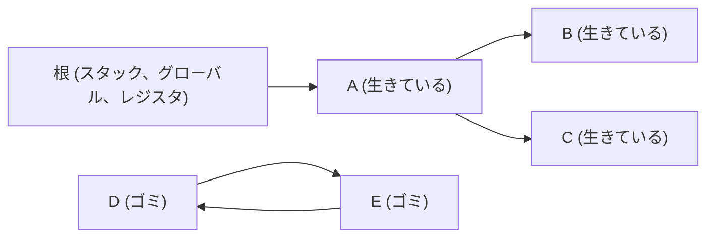
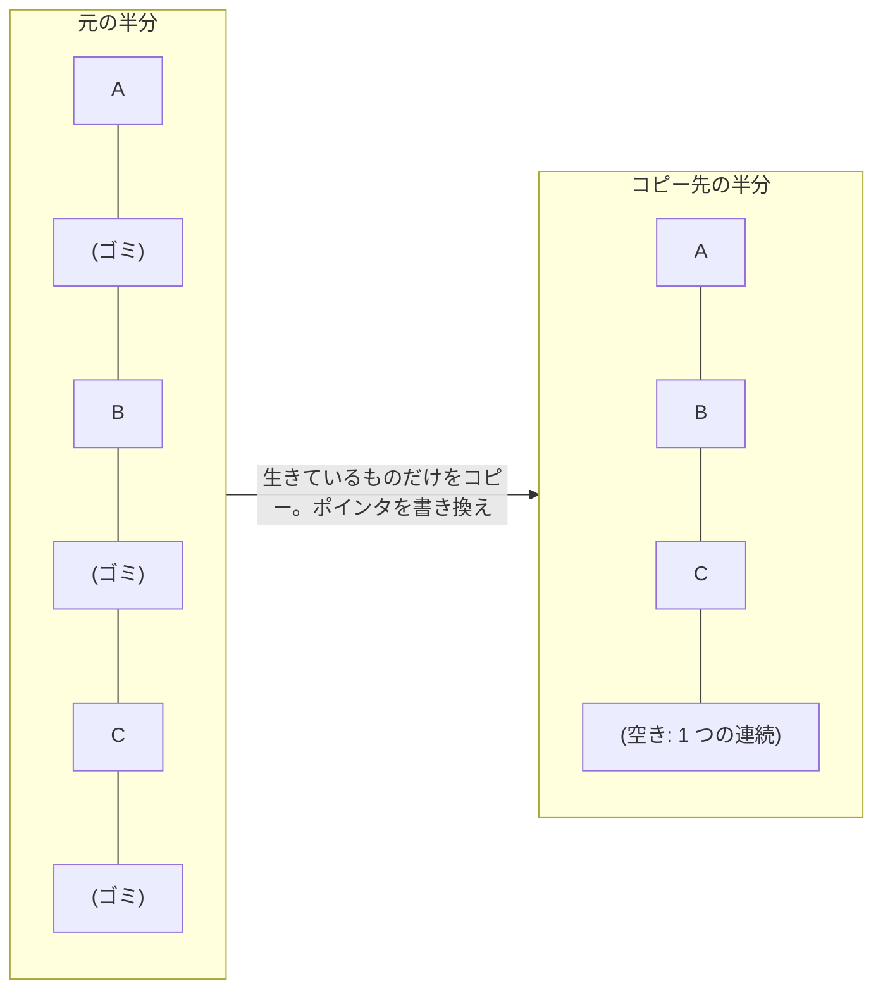
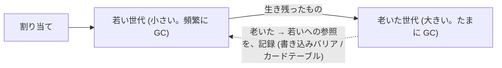

# 図1: GC のアルゴリズム

## 1. 到達可能性



根から、ポインタをたどって到達できるものが「生きている」。D と E は、互いに指しあうが、根から到達できない → ゴミ(循環していても、トレース GC は回収できる)。

## 2. 4 つの方式の比較

| | 参照カウント | マーク & スイープ | コピー (半空間) | 世代別 |
|---|---|---|---|---|
| 解放のタイミング | **すぐ** | GC のとき | GC のとき | 若い世代は頻繁、老いた世代はたまに |
| 循環したゴミ | **漏れる** (演習3 C: 50.0%) | 回収できる | 回収できる | 回収できる |
| 仕事量 | ポインタ更新のたび | 生きている量 + **ヒープ全体** | **生きている量だけ** | 若い世代の生き残りだけ (モデル: 約 8〜10 分の 1) |
| 断片化 | あり | **あり** (演習3 B: 空き 70 万個で、最大の連続 31 個) | **なし** (詰まる) | 方式による |
| 追加のメモリ | カウントの領域 | 印 | **2 倍** | 世代間の記録 |
| 代表 | CPython、Swift、Rust の Rc | Go、(多くの JVM の老いた世代) | JVM の若い世代など | JVM、.NET、V8 |

## 3. コピー (Cheney の半空間)



コピー後、元の半分は、丸ごと空き。次の GC では、役割を交換する。

## 4. 世代別 GC と、弱い世代仮説

```
 割り当てたオブジェクトの寿命 (模式図)

 数 大 ┤█
       │█
       │██
       │███▌
 小    ┤█████▌▌▌▌▌▌▌▌ ……………  (ごく一部が、長く生きる)
       └─────────────────────→ 寿命
         大半は、すぐ死ぬ
```



注意: このモデルは「95% が、すぐ死ぬ」を、仮定した結果である。実際の寿命の分布は、プログラムによる。

## 5. 判断の目安

| 状況 | 傾向 |
|---|---|
| 小さい、寿命の短いオブジェクトが、大量 | 世代別、コピーが有利 |
| 巨大なヒープ、生きている量が多い | コピーは、2 倍のメモリが重い。並行マーク & スイープ |
| C とのポインタ共有 (cgo) | **動かさない** (非移動) 方式が、扱いやすい |
| 決定的な、解放の時刻が必要 | 参照カウント、手動管理 (所有権) |
