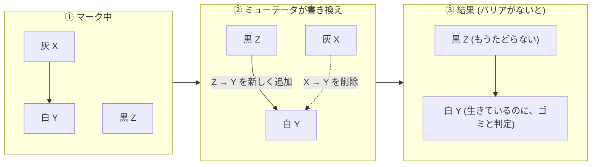
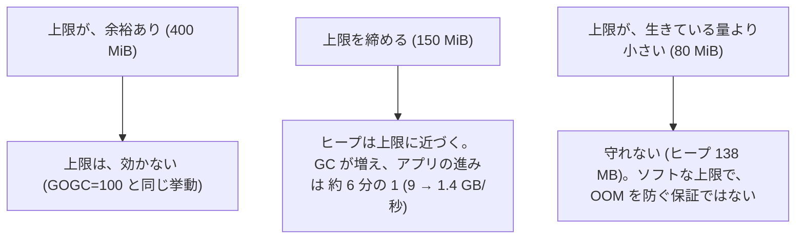
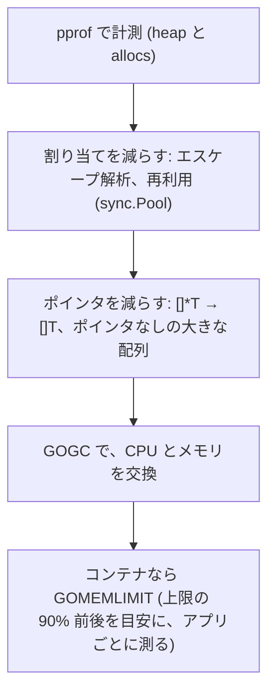

# 図2: 並行 GC、Go の GC、チューニング

## 1. 3 色マークと、見落とし

| 色 | 意味 |
|---|---|
| 白 | まだ見ていない (最後に白のまま = ゴミ) |
| 灰 | 見つけたが、出る参照を、まだたどっていない |
| 黒 | 見つけて、出る参照も、すべてたどった |



見落としは、「**黒が白を指す**」かつ「**灰から白への経路が、すべて断たれる**」の、両方が成り立つときに起きる。

## 2. 書き込みバリア

| 方式 | どちらを防ぐか | 内容 |
|---|---|---|
| 挿入型 (Dijkstra) | 「黒 → 白」 | 書き込むとき、指される白を灰にする |
| 削除型 (Yuasa) | 「灰からの経路が断たれる」 | 参照を消すとき、消える先を灰にする |
| Go | 両方を組み合わせた、ハイブリッド | 代償: GC が動いている間、ポインタの書き込みが遅い |

## 3. Go の GC サイクル


演習2 A の、STW の最大は 21〜36 µs (ヒープの大きさに、ほとんど依存しない)。

## 4. `GOGC` = CPU とメモリの交換レート (演習1、生きている量 100 MB)

| GOGC | GC の CPU 割合 | ヒープの最大 | 割り当て速度 (アプリの進み) |
|---|---|---|---|
| 25 | 72.0% | 160 MB | 2.46 GB/秒 |
| 50 | 71.0% | 199 MB | 5.29 |
| 100 | 51.7% | 322 MB | 9.20 |
| 200 | 24.9% | 833 MB | 14.13 |
| 400 | 13.4% | 2270 MB | 14.64 |

```
 GC の CPU 割合                         ヒープの最大
 72% ┤█                                  2270MB ┤                  █
 51% ┤  █                                 833MB ┤              █
 25% ┤      █                             322MB ┤          █
 13% ┤          █                         160MB ┤  █   █
     └──────────────→ GOGC 25 …… 400            └──────────────→ GOGC 25 …… 400
```

- ヒープの最大は、理論値 (生きている量 × (1 + GOGC/100)) を、**上回った** (仮説: GC のマーク中も、割り当てが続く。未検証)。
- 生きている量を変えても (25 / 100 / 400 MB)、`GOGC=100` の、GC の CPU 割合は、約 50% で一定。

## 5. ポインタの有無と、遅延 (演習2)

| 生きているヒープ | GC 1 回の時間 | タイマーのずれ p99 (GC が動き続ける中) |
|---|---|---|
| ポインタなし 400 MB | **0.11 ms** | 34 µs |
| ポインタだらけ 400 MB | **28.15 ms** | **約 20 ms** |

STW (数十 µs) では説明できない遅延。原因の仮説 (全 P がふさがる、スケジューリングの遅延) は、**未検証**。

## 6. `GOMEMLIMIT` (演習4、生きている量 100 MB)



| 設定 | ヒープの最大 | 割り当て GB/秒 |
|---|---|---|
| GOGC=100 | 322 MB | 8.89 |
| off + 400 MiB | 372 MB | 10.45 |
| off + 250 MiB | 229 MB | 6.58 |
| off + 150 MiB | 135 MB | 1.40 |
| off + 80 MiB | 138 MB | 0.95 |

## 7. チューニングの順序


