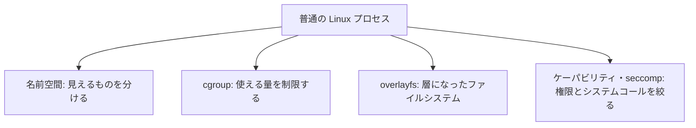
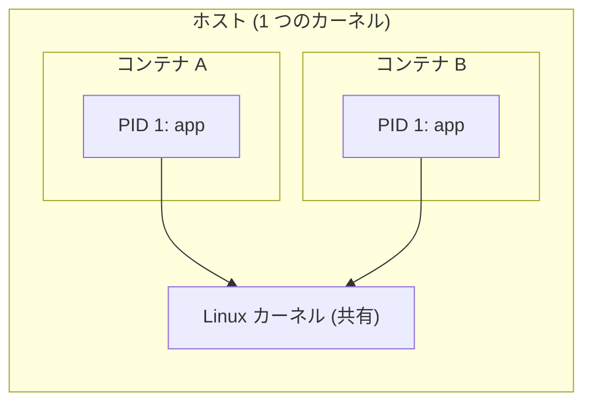
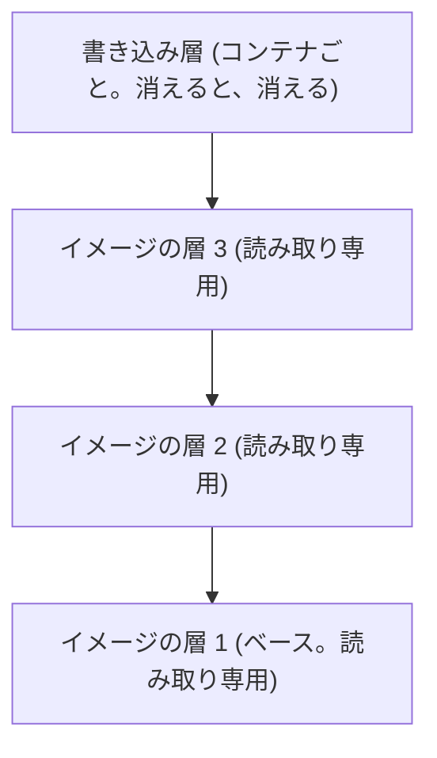
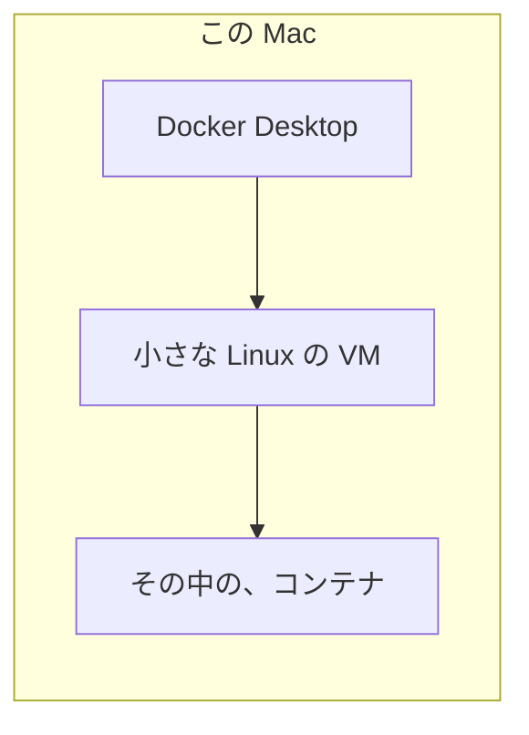

# 図3: 名前空間、cgroup、コンテナ

> この図は、公開された仕様の知識による。この講義の演習では、実行していない (macOS では動かせない)。

## 1. コンテナ = 普通のプロセス + 隔離 + 制限

## 2. 名前空間

| 名前空間 | 分けるもの |
|---|---|
| PID | プロセス番号 (コンテナ内の最初が PID 1) |
| NET | ネットワークデバイス、ルーティング、ポート |
| MNT | マウントの木 |
| UTS | ホスト名 |
| IPC | System V IPC |
| USER | ユーザ ID の対応 (内の root = 外の一般ユーザ) |
| CGROUP | cgroup の見える範囲 |
| TIME | 時計のオフセット |

どちらも PID 1 に見えるが、ホストからは、別の番号の、普通のプロセス。**カーネルは共有**。

## 3. cgroup v2

| ファイル | 内容 | 超えると |
|---|---|---|
| `cpu.max` (`200000 100000`) | 周期 100 ms あたり 200 ms | **スロットリング** (周期の残りは、全スレッドが止まる) |
| `cpu.weight` | 取り合いのときの比率 | 比率に応じて配分 (上限ではない) |
| `memory.max` | ハードな上限 | 回収しても足りないと **OOM → SIGKILL (exit 137)** |
| `memory.high` | ソフトな上限 | 回収が強まり、遅くなる (殺さない) |
| `pids.max` | プロセス数 | フォークが失敗 |
| `io.max` | ブロック I/O の帯域・IOPS | 待たされる |

## 4. overlayfs

ファイルを変更 → 下の層から書き込み層へ**コピー** (コピーオンライト。第2回の fork と同じ考え方)。永続データは、**ボリューム**に置く。

## 5. コンテナ・VM・マイクロVM

| | コンテナ | VM | マイクロVM / ユーザ空間カーネル |
|---|---|---|---|
| カーネル | ホストと共有 | ゲスト専用 | ゲスト専用 (最小) / ユーザ空間で処理 |
| 隔離 | 弱い (カーネルの攻撃面) | 強い | 強い〜中 |
| 重さ | 軽い | 重い | 軽い |
| 例 | Docker + runc | KVM、Xen | Firecracker、gVisor |

macOS のコンテナは、**VM の上のコンテナ**。名前空間と cgroup は Linux のカーネルの機能で、macOS にはない。
