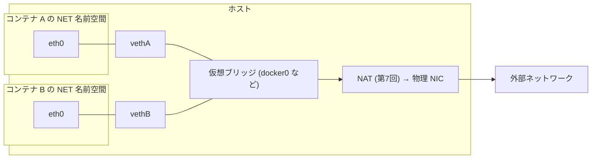
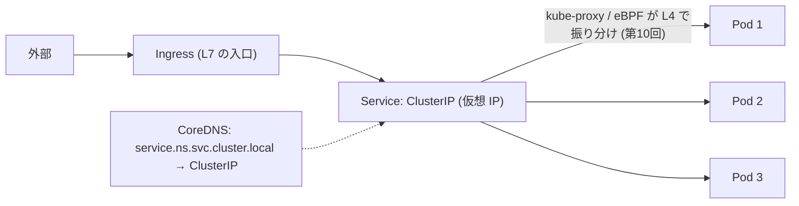
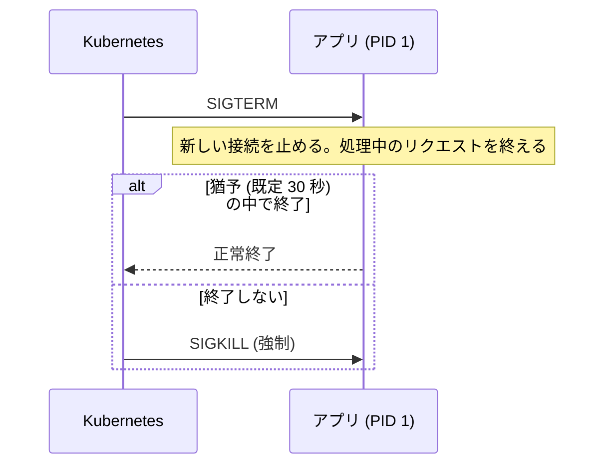

# 図4: コンテナのネットワークと、CPU スロットリング

> ネットワークの構成は、公開された仕様の知識による (未実行)。CPU スロットリングの数値は、演習5 のモデルの結果であり、実システムの値ではない。

## 1. ブリッジ + veth



- コンテナ同士: ブリッジで、L2 で通信。
- 外へ: **NAT**。外から入る: ポートの公開 (DNAT)。

## 2. 複数ホストをまたぐ

| 方式 | 仕組み | 代償 |
|---|---|---|
| オーバーレイ (VXLAN など) | パケットを、別のパケットで包む | ヘッダ分の **MTU の減少** (第7回の MTU の黒穴)、カプセル化のコスト |
| ルーティング型 | ホストが、コンテナのサブネットを BGP で広告 (第10回) | ネットワーク機器の協力が要る |

## 3. Kubernetes の通信



## 4. CFS 帯域制御 (`cpu.max = 200000 100000`)

```
 周期 100 ms

 8 スレッドが同時に走る場合 (8 コアのホスト):

 CPU を使う  ████████░░░░░░░░░░░░░░░░░░░░░░░░░░░░░░░░░░░░░░░░░░░░░░░░░░░░░░░░░░░░░░░░░░░
 時間        0                25 ms                                              100 ms
             └ 8 × 25 ms = 200 ms を使い切る ┘ └──── 残りの 75 ms は、全スレッドが停止 ────┘
```

「2 CPU」は、**周期あたりの、合計の量**であり、**瞬間**の話ではない。

## 5. シミュレーション (演習5: 上限 200 ms / 100 ms、1 件 = CPU 20 ms、T = 8)

| 平均の使用率 | p50 | p99 | スロットリングされた周期 |
|---|---|---|---|
| 30% | 20 ms | 20 ms | 0.1% |
| 50% | 20 | 22 | 1.9% |
| 70% | 20 | 55 | **14.6%** |
| 90% | 20 | **218** | **57.3%** |

- 平均が上限より低くても (70%)、**瞬間的な重なり**で、スロットリングが起きる。
- スレッド数 T を増やすと、スロットリングは増えたが、このモデルでは、p99 は T=2 より、同じか良かった (T=2 は、待ち行列で遅れる)。「スレッドが多いほど悪い」は、示せなかった。

## 6. Kubernetes の設定とカーネルの設定

| Kubernetes | カーネル | 超えると |
|---|---|---|
| `requests.cpu` | `cpu.weight` + スケジューリング | (取り合いのときの比率) |
| `limits.cpu` | `cpu.max` | スロットリング |
| `limits.memory` | `memory.max` | **OOM、exit 137** |

## 7. 終了の流れ



PID 1 は、`SIGTERM` の既定の処理が、通常のプロセスと違う。Go では、`signal.Notify` で、明示的に処理する。
