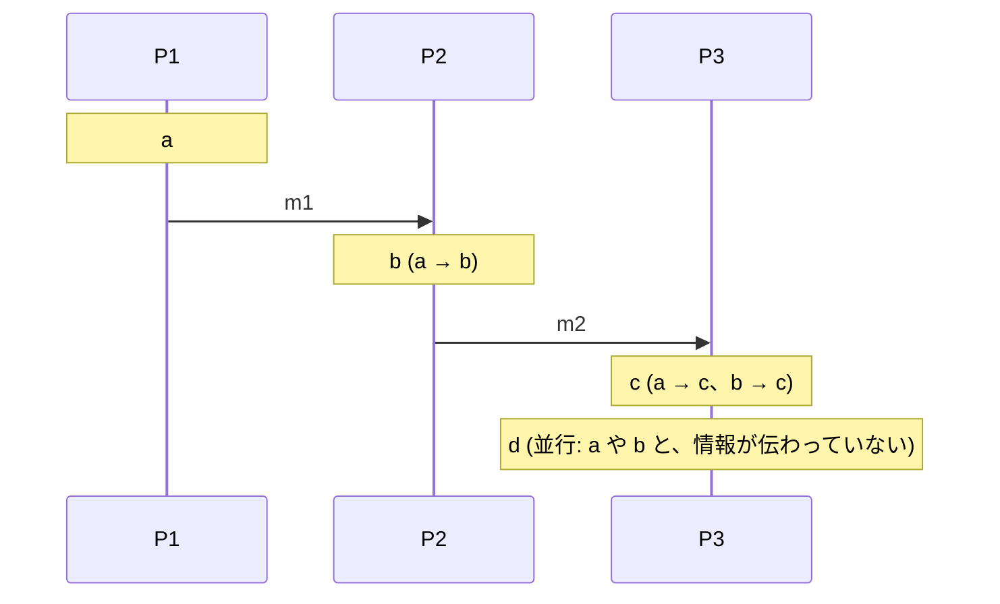
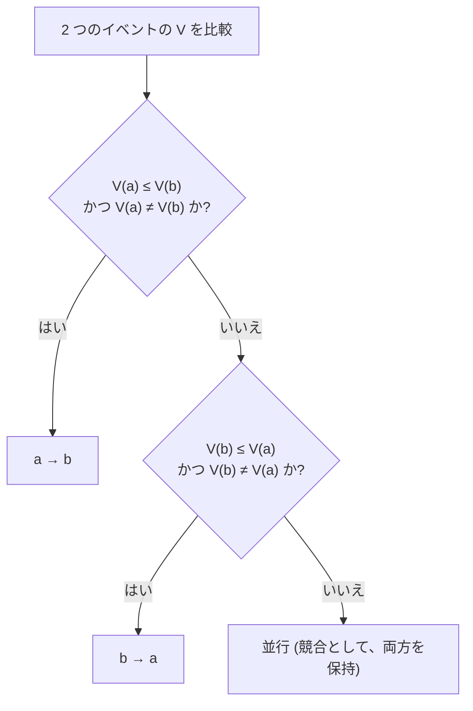
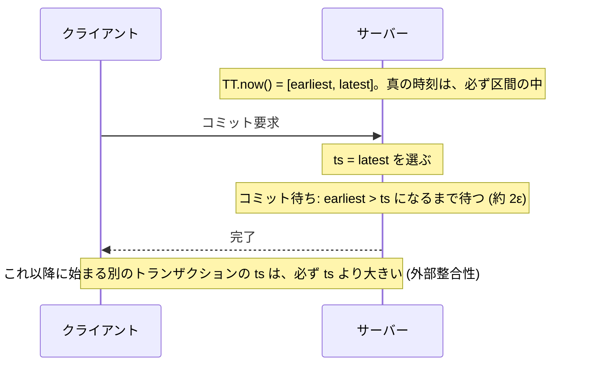

# 図1: 時間と順序

## 1. 時計のずれと、LWW (演習2 A)

```
 真の時刻 →   0 ms          Δ=2 ms
 ノード 1     書く ●  (時計が +3 ms 進んでいる → 記録: 3)
 ノード 2                    ● 書く (時計が −1 ms 遅れている → 記録: 1)

 LWW (大きい時刻を残す): 3 > 1 → 先の書き込みが勝つ。後の書き込みは、静かに失われる
```

後の書き込みが負ける確率 (モデル):

| Δ \ σ | 1 ms | 10 ms | 50 ms |
|---|---|---|---|
| 0.5 ms | 36.15% | 48.46% | 49.88% |
| 10 ms | 0.00% | 23.82% | 44.27% |
| 200 ms | 0.00% | 0.00% | 0.23% |

## 2. happened-before



| 関係 | 意味 |
|---|---|
| a → b | 同じプロセスで前、または、送信と受信、または、推移的 |
| 並行 | どちらの向きにも、情報が伝わりえなかった。「同時刻」ではない |

## 3. 3 つの論理時計

| | Lamport 時計 | ベクタークロック | HLC |
|---|---|---|---|
| 持つもの | 整数 1 つ | 全プロセスの整数の組 | (物理時刻に近い l, 論理カウンタ c) |
| a → b ⇒ | L(a) < L(b) | V(a) < V(b) | ts(a) < ts(b) |
| 逆 (大小 ⇒ 因果) | **成り立たない** | **成り立つ (正確)** | 成り立たない |
| 並行の検出 | できない | **できる** | できない |
| 大きさ | 8 バイト | **8 × プロセス数** | 約 12 バイト |
| 物理時刻との近さ | なし | なし | **近い** |

演習1 (5 プロセス、700 イベント、24 万 4,650 対):

| 項目 | 結果 |
|---|---|
| a → b なのに L(a) ≥ L(b) | 0 対 |
| L(a) < L(b) の対のうち、実は並行 | **11.4%** |
| ベクタークロックの判定が、正解と違う | 0 対 |

## 4. ベクタークロックの比較

```
 V(a) = (2, 1, 0)      V(b) = (2, 3, 1)   → すべて ≤、かつ ≠ → a → b
 V(a) = (2, 1, 0)      V(c) = (1, 2, 0)   → どちらの向きも成り立たない → 並行
```



## 5. 因果的な書き込みの順序 (演習2 B)

| σ | 物理時計 (LWW) | HLC |
|---|---|---|
| 1 ms | 14.93% が逆転 | **0.00%** |
| 10 ms | 45.74% | **0.00%** |
| 50 ms | 49.19% | **0.00%** |

## 6. TrueTime とコミット待ち



| ε | コミット待ちなし: 逆転 | あり: 逆転 / 平均の待ち |
|---|---|---|
| 1 ms | 49.95% | 0% / 2.00 ms |
| 7 ms | 49.95% | 0% / 14.00 ms |
| 20 ms | 50.03% | 0% / 40.00 ms |

(ほぼ自明なモデル。構造を示すもので、実際の Spanner の数値ではない。)

## 7. 3 つの態度

| 態度 | 例 | 結果 |
|---|---|---|
| 不確かさを、無視する | 物理時計の LWW | 静かに失う |
| 因果だけを使う | Lamport、ベクタークロック、HLC | 因果は正確。並行の、真の時刻順は分からない |
| 不確かさを明示し、待つ | TrueTime | 正しい。待ち時間 約 2ε の代償 |
