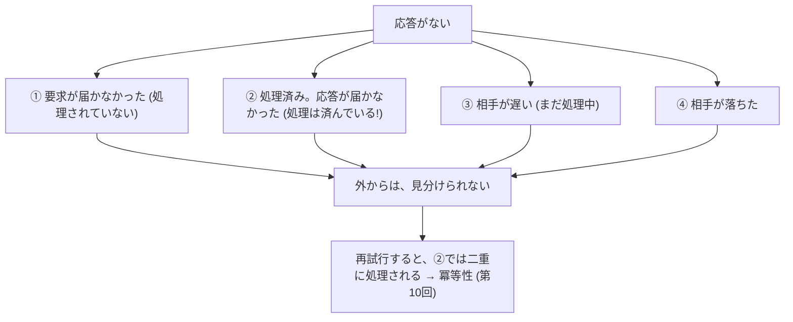
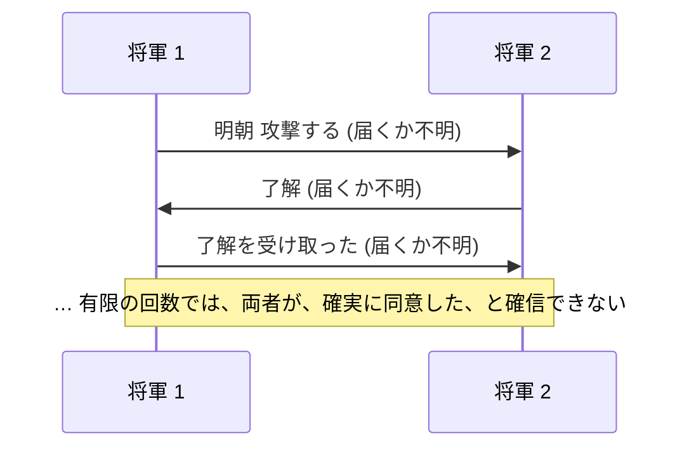
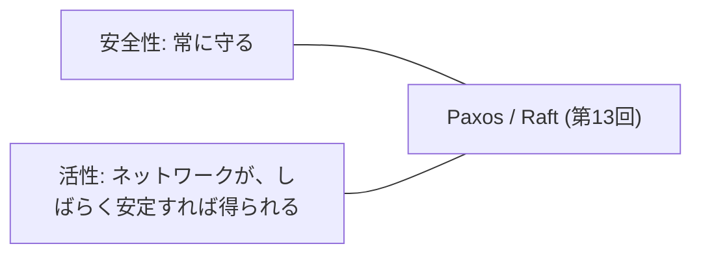

# 図2: 故障、故障検出、不可能性

## 1. 応答がないとき、何が起きたか



## 2. システムモデル

| タイミング | 仮定 | 備考 |
|---|---|---|
| 同期 | 遅延に、既知の上限 | 現実には、保証できない |
| 非同期 | 上限なし | 安全側。FLP が成り立つ |
| **部分同期** | 上限はあるが未知、または、いつか成り立つ | **現実的。Paxos、Raft** |

| 故障 | 内容 | 必要なノード数 (f 個の故障に耐える) |
|---|---|---|
| クラッシュ停止 | 止まって戻らない | 2f + 1 (多数派) |
| クラッシュ・リカバリ | 再起動して、ディスクの状態から復帰 | 2f + 1 |
| ビザンチン | 任意の誤動作 | 3f + 1 (第13回) |

## 3. 故障検出のトレードオフ (演習3)

ハートビート 100 ms。まれに (0.2%) 200〜2000 ms の停止 (GC、喪失、スロットリング)。10 時間分。

到着間隔: p50 = 100 ms、p99 = 104 ms、**p99.9 = 1,183 ms**、最大 = 2,096 ms (裾が重い)。

| 固定の T (ms) | 誤検出 (10 時間) | 検出時間 (平均) |
|---|---|---|
| 150 | 715 | 100 ms |
| 500 | 623 | 450 |
| 1,000 | 433 | 950 |
| 2,000 | 36 | 1,950 |
| 3,000 | **0** | 2,950 |

```
 誤検出                                       検出時間
 715 ┤█                                       3000 ┤                   █
 623 ┤   █                                    1950 ┤              █
 433 ┤       █                                 950 ┤        █
  36 ┤            █                            450 ┤   █
   0 ┤                 █                       100 ┤█
     └─────────────────→ T 150 …… 3000             └─────────────────→ T 150 …… 3000
```

| φ の閾値 | 誤検出 | 検出時間 |
|---|---|---|
| 1 | 4,146 | 111 ms |
| 8 | 685 | 319 |
| 16 | 625 | 444 |

このモデルでは、φ 検出器は、固定のタイムアウトと同等 (仮説: 裾が重く、正規分布の仮定に合わない。未検証)。

## 4. 2 人の将軍



失われうる通信では、確定的な合意は、作れない。

## 5. FLP の不可能性 (1985)

| | 内容 |
|---|---|
| 主張 | **非同期**で、**1 つのプロセスが、クラッシュしうる**だけで、**決定的**な合意のアルゴリズムで、**必ず終了すること**を保証するものは、ない |
| 不可能なのは | **活性** (必ず終わる) |
| 守れるのは | **安全性** (誤った合意をしない) |
| 回避の方法 | 部分同期 (タイムアウト)、乱数、故障検出器 |
| 誤解 | 「合意は不可能」ではない。Paxos、Raft は、安全性を常に守り、安定すれば終わる |


