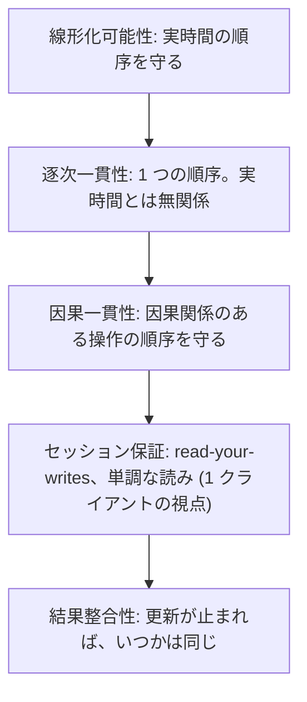
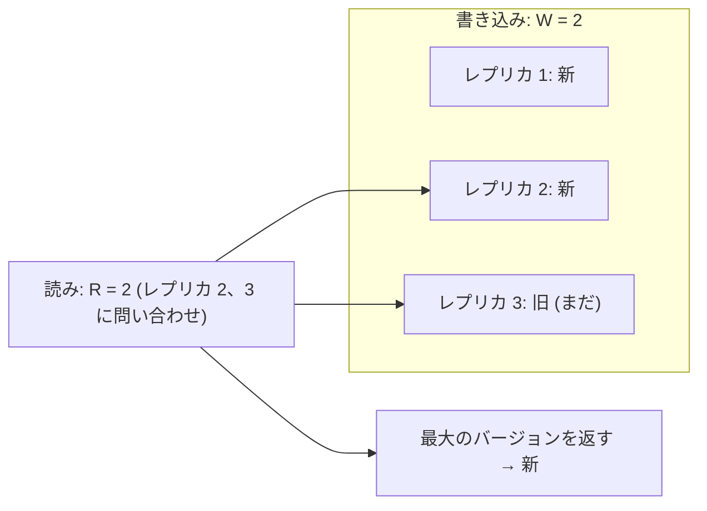
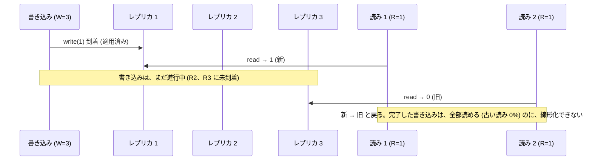
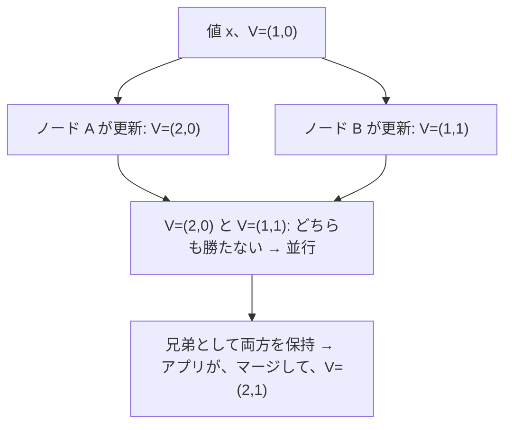

# 図3: 一貫性モデルとクォーラム

## 1. 一貫性モデルの強さ



上ほど、プログラムは書きやすい。下ほど、速く、可用性が高い。

## 2. 線形化可能性

各操作が、**開始と応答の間の、ある 1 点で、瞬時に起きた**ように並べられる。

```
 時間 →
 クライアント A:  [──── write(1) ────]
 クライアント B:        [─ read → 1 ─]            ← write の最中に、新しい値を見た
 クライアント C:                          [─ read → 0 ─]   ← その後に、古い値 → 線形化できない
```

B が 1 を見たなら、write の効果は、B の読みより前。C の読みは、B の後なので、1 でなければならない。0 を返すと、**新 → 旧 と戻る**。

## 3. クォーラム (N = 3)



R + W > N なら、読みと書きの集合が、**必ず交わる** → **完了した**書き込みを、読める。

## 4. 演習4: 線形化できない履歴の割合 (N = 3、12 操作の履歴 4,000 個)

混んでいる (操作の間の待ち 平均 1 ms):

| R | W | R+W>N | 線形化できない | 古い読み |
|---|---|---|---|---|
| 1 | 1 | いいえ | **96.4%** | 48.7% |
| 1 | 2 | いいえ | 35.7% | 3.3% |
| 2 | 2 | はい | 0.4% | 0.0% |
| 1 | 3 | はい | **25.5%** | 0.0% |
| 3 | 1 | はい | 0.0% | 0.0% |
| 3 | 3 | はい | 0.0% | 0.0% |

空いている (平均 20 ms):

| R | W | R+W>N | 線形化できない | 古い読み |
|---|---|---|---|---|
| 1 | 1 | いいえ | 71.2% | 19.8% |
| 1 | 3 | はい | 8.8% | 0.0% |
| 2 | 2 | はい | 0.0% (1/4000) | 0.0% |

## 5. なぜ R = 1、W = 3 は、崩れるか



**R + W > N の保証 = 「完了した書き込みを、必ず読める」**。進行中の書き込みがあるときの、読みの順序は、保証しない。対策: 読みの修復 (read repair)、読みの前に書き戻す、合意アルゴリズム (第13回)。

## 6. 「古い読みがない」≠「線形化可能」

| | 古い読み | 線形化可能 |
|---|---|---|
| R=1、W=3 | 0% | **崩れる (25.5%)** |
| R=3、W=1 | 0% | 崩れなかった (0%) |

## 7. ベクタークロックと競合の保持 (第14回の予告)


