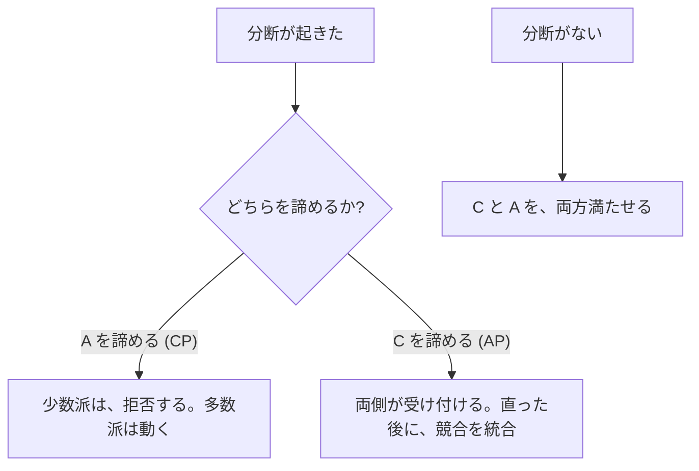
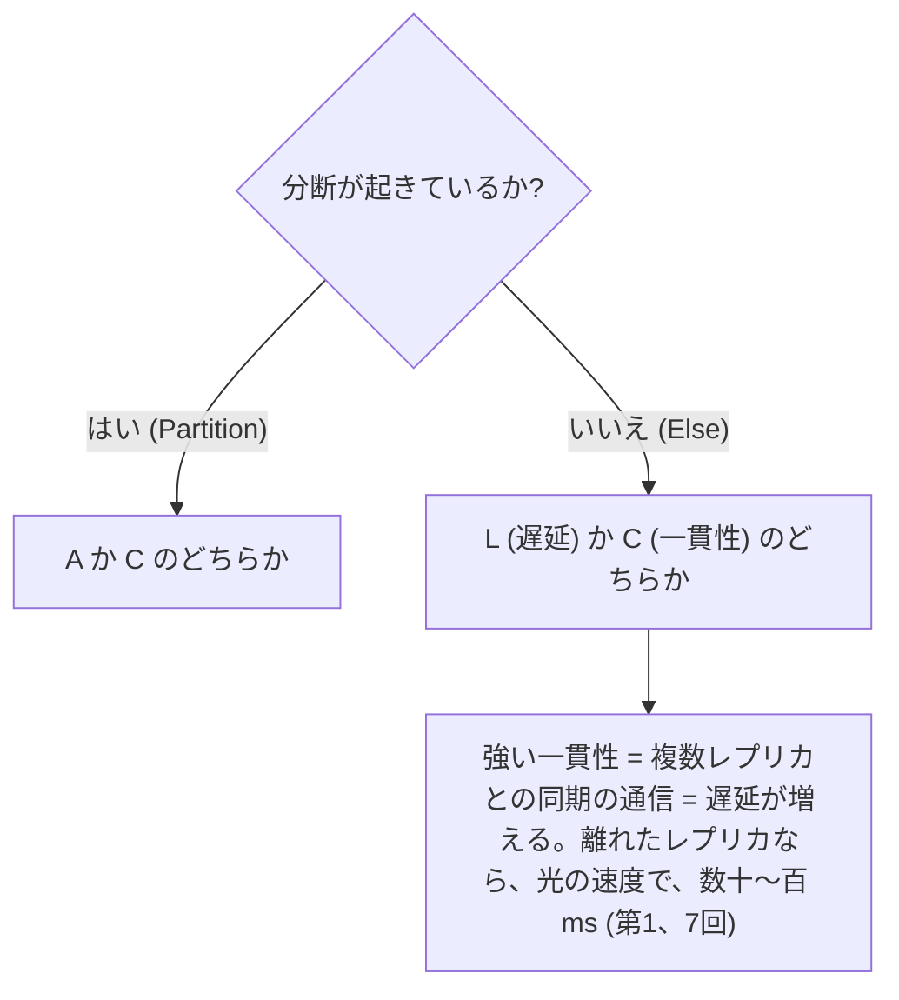
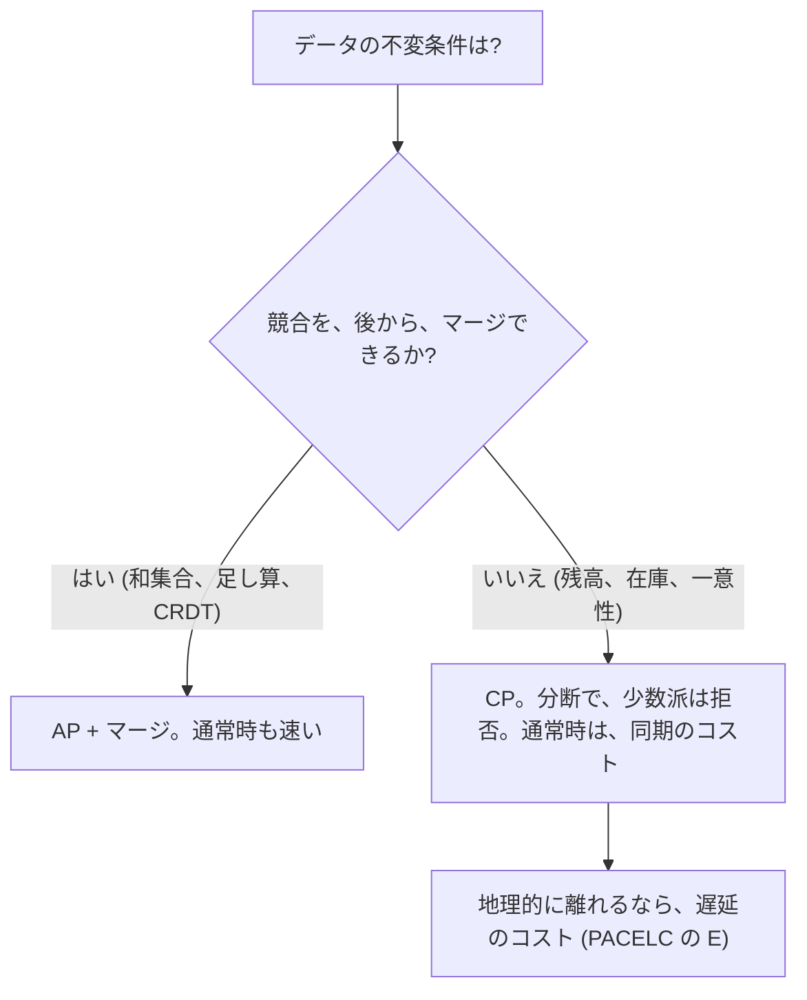

# 図4: CAP と PACELC

## 1. CAP の正確な主張

> **ネットワークの分断 (P) の間**、1 つのレジスタについて、**線形化可能性 (C)** と **可用性 (A)** は、同時には満たせない。

| 用語 | 正確な意味 |
|---|---|
| C | 線形化可能性 (ACID の C ではない) |
| A | 生きている全てのノードが、いつかは応答する (遅延の目標ではない) |
| P | 分断が起きても、システムは動く |



## 2. 誤解

| 誤解 | 正しくは |
|---|---|
| 3 つのうち 2 つを選ぶ | 分断は選べない。**起きたときに**、C と A のどちらを諦めるか |
| CP は、可用性ゼロ | **多数派の側は動く** (演習5: 多数派側 100%) |
| C は ACID の C | 違う。線形化可能性 |
| システム全体を、CP か AP に分類 | データ、操作ごとに違いうる |
| A は、実用上の可用性 | 「いつかは応答」という、非常に弱い定義 |

## 3. 演習5: 分断の間 (5 ノード、{A,B,C} と {D,E}。10〜20 秒。150 件の書き込み)

```
 時刻 →   0 ─────────── 10 ─────────── 20 ─────────── 30 秒
                         ╳ 分断 ╳
            {A, B, C} ──── 通信できない ──── {D, E}
```

| | 成功 (全体) | 分断中 | 少数派側 |
|---|---|---|---|
| **CP** | 130 / 150 (86.7%) | 30 / 50 (60.0%) | **0%** (拒否) |
| **AP** | 150 / 150 (100%) | 50 / 50 | 100% |

AP の、分断後: 両側が書いたキーが、20 個のうち **9 個 → 競合**。

| 統合の方法 | 結果 |
|---|---|
| LWW | 9 件の書き込みが、**成功を返したのに失われた** (150 件の 6.0%) |
| 競合を保持 (兄弟) | 9 キーで、18 個の値が残る。**アプリが、マージする責任** |

## 4. データの意味で決める

| データ | 向く方式 | 理由 |
|---|---|---|
| 銀行の残高、在庫の最後の 1 個 | CP | 二重に使えない |
| 買い物かご | AP + マージ (和集合) | 後で、統合できる |
| いいねの数 | AP + CRDT (カウンタ) | 足し算は、順序に依らない |
| セッション情報 | AP でも多くは可 | 失っても、再ログインで済む |

(典型例。実際は、要件による。)

## 5. PACELC



| 分類 (典型例。製品、設定による) | 分断の間 | 通常時 |
|---|---|---|
| PA/EL | 可用性 | 遅延 |
| PC/EC | 一貫性 | 一貫性 |
| PA/EC、PC/EL | 組み合わせ | |

## 6. 設計の判断の流れ


