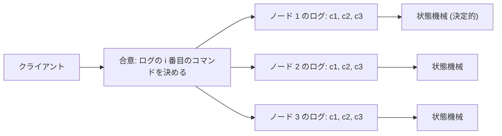
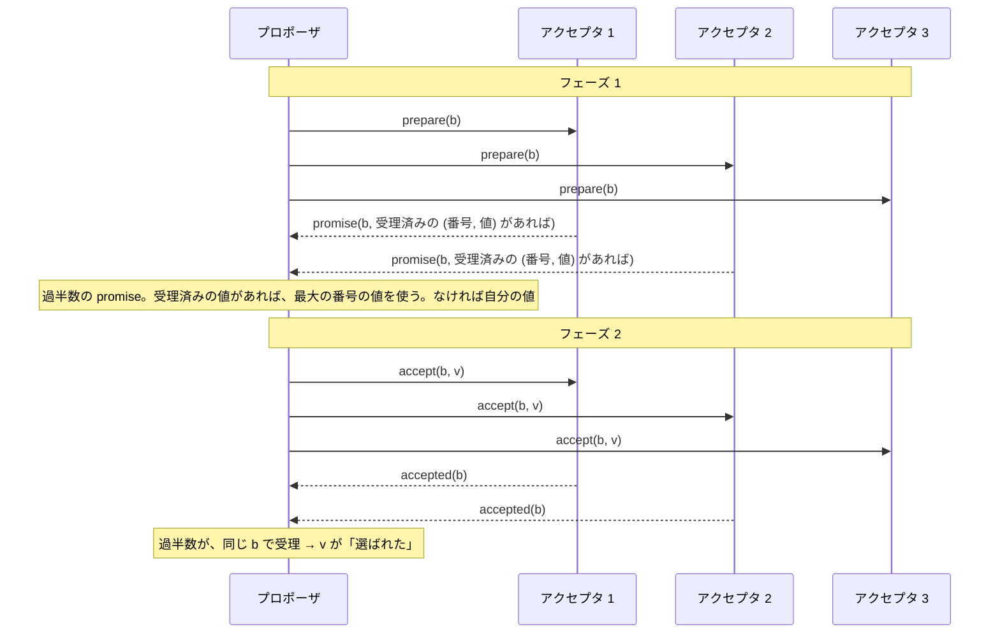
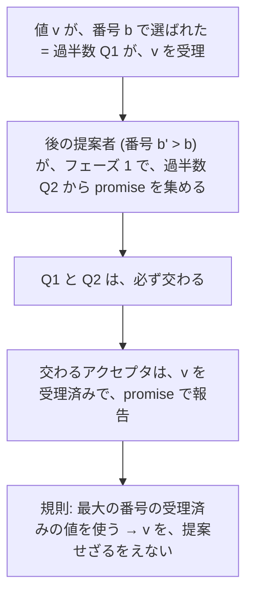
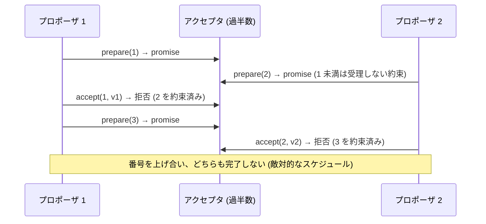

# 図1: 複製状態機械と Paxos

## 1. 複製状態機械

全ノードが、同じ順序で、同じコマンドを適用 → 同じ状態。問題は、「順序の合意」。

## 2. 合意の 3 性質

| 性質 | 種類 | Paxos / Raft |
|---|---|---|
| 一致 | 安全性 | **常に守る** |
| 妥当性 | 安全性 | **常に守る** |
| 終了 | 活性 | ネットワークが安定すれば (FLP との折り合い) |

## 3. Paxos の 2 フェーズ

アクセプタの規則:

| メッセージ | 条件 | 動作 |
|---|---|---|
| prepare(b) | b > 約束した番号 | b 未満は受理しないと約束。受理済みの最大の (番号, 値) を返す |
| accept(b, v) | b ≥ 約束した番号 | 受理 (番号と値を記録) |

**状態 (約束した番号、受理した番号と値) は、永続化する** (再起動で忘れると、安全性が破れる)。

## 4. なぜ安全か

## 5. 演習1 の結果 (2,000 回の実行。喪失 10%、重複 5%、クラッシュ)

| 版 | 安全性の違反 |
|---|---|
| 正しい Paxos + バックオフ | **0 / 2000** |
| 正しい Paxos、バックオフなし | **0 / 2000** |
| 壊した版 (a): 受理済みの値を無視 | **2000 / 2000** |
| 壊した版 (b): 再起動で状態を忘れる | **7 / 2000** (まれ。100 回では、見逃しうる) |

## 6. デュエリング・プロポーザ (活性)

対策: 唯一のリーダー、ランダムなバックオフ。演習1 は、ランダムな遅延のため、バックオフなしでも起きなかった (敵対的なスケジュールは、作っていない)。

## 7. Multi-Paxos

| | 単一値を、毎回 | Multi-Paxos |
|---|---|---|
| フェーズ 1 | インスタンスごとに | リーダー就任時に 1 回 (全インスタンス分) |
| フェーズ 2 | インスタンスごと | インスタンスごと (1 往復) |
| 書き込みの遅延 | 2 往復 | **1 往復** (安定したリーダーがいるとき) |
