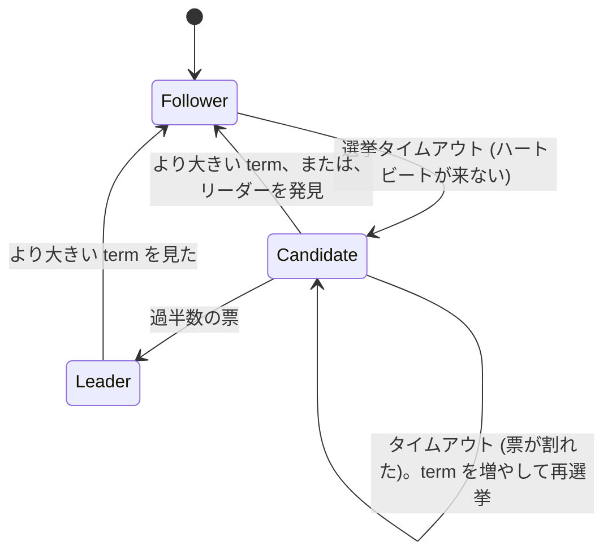
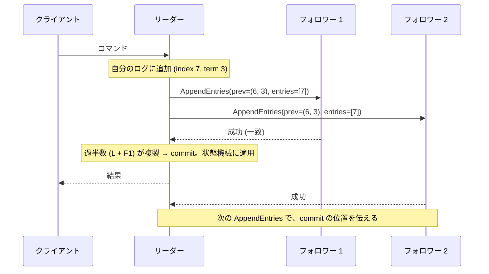
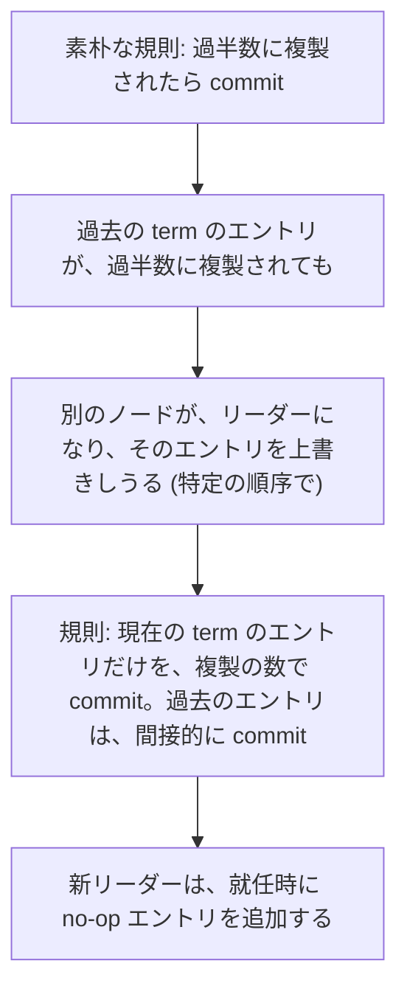

# 図2: Raft

## 1. 状態遷移



- 時間は **term** (単調に増える整数) に区切られる。**1 つの term に、リーダーは高々 1 人**。
- 各ノードは、**1 つの term に、1 票だけ** (`votedFor` を永続化)。
- 選挙タイムアウトは **ランダム** (例: 150〜300 ms)。

## 2. 選挙の制限 (投票の条件)

```
 候補者のログが、自分のログより古い → 投票しない
 「古い」= 最後のエントリの term が小さい、または、同じ term で index が小さい
```

→ **commit 済みのエントリを、全て持つノードだけが、リーダーになれる**。

演習2 C2 (この制限を外す): **300 / 300 の実行で、リーダーの完全性と、状態機械の安全性が破れた**。

## 3. ログの複製



**ログの一致**: AppendEntries は、直前の (index, term) を含む。フォロワーは、それが自分のログに、あるときだけ受け入れる。なければ、リーダーが、後ろへ戻って再送。

## 4. ログの食い違いと修復

```
 リーダー (term 8):   1:1  2:1  3:1  4:4  5:4  6:5  7:5  8:6  9:6  10:6
 フォロワー a:        1:1  2:1  3:1  4:4  5:4  6:5  7:5  8:6  9:6          (短い → 追記される)
 フォロワー b:        1:1  2:1  3:1  4:4  5:4  6:5  7:5  8:6  9:6  10:6  11:6 (長い。11 を、削除)
 フォロワー c:        1:1  2:1  3:1  4:4  5:4  6:5  7:5  7':7 (term 7 の、別のエントリ → 上書きされる)
```

リーダーのログは追記のみ。フォロワーの食い違いは、リーダーのログで上書き。

## 5. commit の規則 (Figure 8)



演習2 C1 (この規則を外す): ランダムな障害 300 回では、**検出できなかった** (論文が示す、特定の順序に、当たらなかった。規則が不要ということではない)。

## 6. 演習2 A: 選挙タイムアウトの範囲 (リーダーのクラッシュ後、各 400 回)

| 範囲 | p50 | p99 | 選挙の回数 | 決まった実行 |
|---|---|---|---|---|
| [150, 300) ms | 165 ms | 425 ms | 1.20 | 400 / 400 |
| [150, 160) ms | 310 ms | 1,695 ms | 6.79 | 393 / 400 |
| [150, 151) ms | — | — | — | **0 / 400** (60 秒) |
| [1500, 3000) ms | 1,755 ms | 2,715 ms | 1.01 | 400 / 400 |

```
 幅が広い  → 票は割れにくい。検出は、最小値で決まる
 幅が狭い  → 票が割れ続ける (活性の喪失)
 値が大きい → 割れないが、リーダーの故障の検出が遅い (第12回の、故障検出のトレードオフ)
```

## 7. 演習2 B: 障害注入 (5 ノード、20 秒 × 300 回、喪失 5%、重複 2%、クラッシュ、分断)

| 版 | 違反が出た実行 |
|---|---|
| 正しい Raft | **0 / 300** |
| C1: 過去の term も、複製数で commit | 0 / 300 (検出できず) |
| C2: 選挙の制限なし | **300 / 300** |

実装で、最初に見つけたバグ: 重複した VoteReply を、二重に数え、同じ term に 2 人のリーダーが生まれた (選出の安全性の違反)。投票者を集合で記録して解決。

## 8. 読み (第12回の線形化可能性との接続)

| 方法 | 内容 | 代償 |
|---|---|---|
| ログに書く | 読みも合意を通す | 遅い |
| ReadIndex | 読みの前に、過半数に、まだリーダーかを確認 | 1 往復 |
| リース | 時計で、他のリーダーがいないことを保証 | 時計のずれ (第12回) |
| フォロワーから | 速い | 古い値 (線形化可能でない) |
