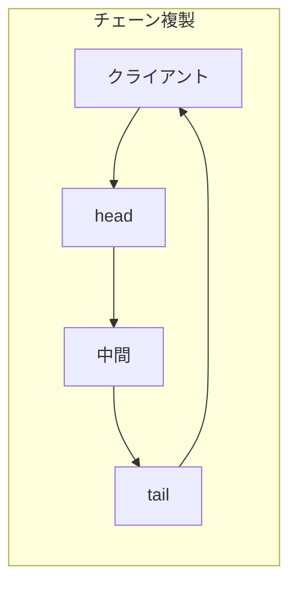
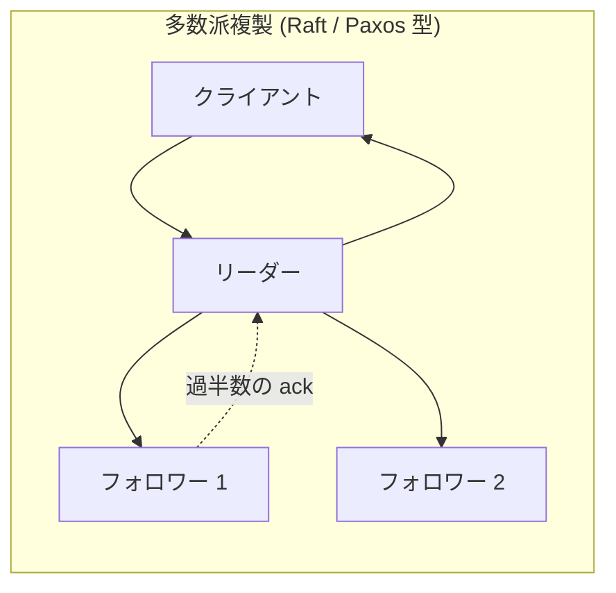
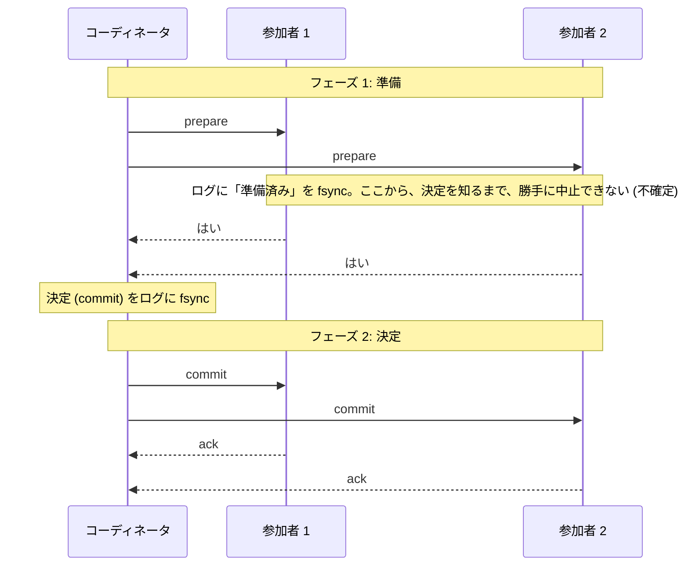
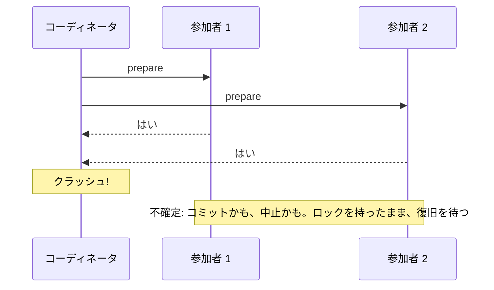
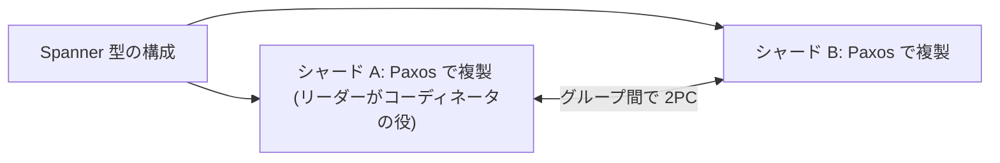

# 図3: チェーン複製、多数派複製、2 相コミット

## 1. 3 つの複製方式





| 方式 | 書き込みの遅延 | 読み | 弱点 |
|---|---|---|---|
| チェーン | **鎖の長さに比例** (直列) | tail が答える (強い一貫性、安い) | 鎖のどのノードが遅くても遅い |
| 多数派 | 並列で、過半数の ack | リーダー (読みに注意) | リーダーに、集中 |
| 全員の ack | 並列で、全員の ack | どこでも | 1 つの遅れで遅い |

## 2. 演習4 の結果 (書き込みの遅延、ms)

停止なし:

| 方式 | p50 | p99 |
|---|---|---|
| チェーン N=3 | 3.84 | 7.03 |
| 多数派 N=3 | 3.48 | 6.14 |
| チェーン N=5 | **5.84** | 9.57 |
| 多数派 N=5 | **3.58** | 6.17 |

各ホップで 5% の確率で、50 ms の停止:

| 方式 | p50 | p99 | p99.9 | 平均 |
|---|---|---|---|---|
| チェーン N=5 | 6.42 | **106.66** | 156.12 | 21.00 |
| 多数派 N=5 | 3.77 | **55.10** | 103.95 | 8.95 |
| 全員の ack N=5 | 5.72 | 104.88 | 153.73 | 26.78 |

停止 1% では、p99 の差は小さい (N=3: チェーン 54.6、多数派 53.5)。

```
 p99 (停止 5%、N=5)
 チェーン      ████████████████████████████████████████████  106.7 ms
 全員の ack    ███████████████████████████████████████████   104.9 ms
 多数派        █████████████████████                          55.1 ms
```

## 3. 2 相コミット



## 4. ブロッキング



| クラッシュの時点 | 参加者の状態 |
|---|---|
| ① 準備を送る前 | 誰も準備していない → 中止できる |
| ② 投票を集めた後、決定を記録する前 | 不確定 (復旧後、中止) |
| ③ 決定を記録した後、送る前 | 不確定 (復旧後、ログから commit) |
| ④ 一部にだけ送った後 | 決定を知った参加者に聞けば解決 (協調的な終了) |

## 5. 演習3 の結果 (100 万トランザクション、クラッシュ 1%)

| 版 | ロック保持 p50 / p99.999 / 最大 | 原子性の違反 |
|---|---|---|
| A. 標準 (復旧 平均 10 秒) | 0.010 / 64.1 / **106.7 秒** | **0** |
| B. コーディネータを複製 (0.3 秒で引き継ぎ) | 0.010 / 0.3 / **0.3 秒** | 0 |
| C. 独断で、1 秒後に中止 | 0.010 / 1.0 / 1.0 | **3,935** |

(復旧の時間とクラッシュの時点の分布は、モデルの仮定。構造を示すもので、実システムの数値ではない。)



## 6. 3PC と Paxos Commit

| | 内容 | 注意 |
|---|---|---|
| 3PC | ブロックを避ける | 同期モデルを仮定。分断で安全性が破れる。実用では少ない |
| Paxos Commit | 各参加者の投票を、Paxos で複製 | コーディネータの故障でも進める |
