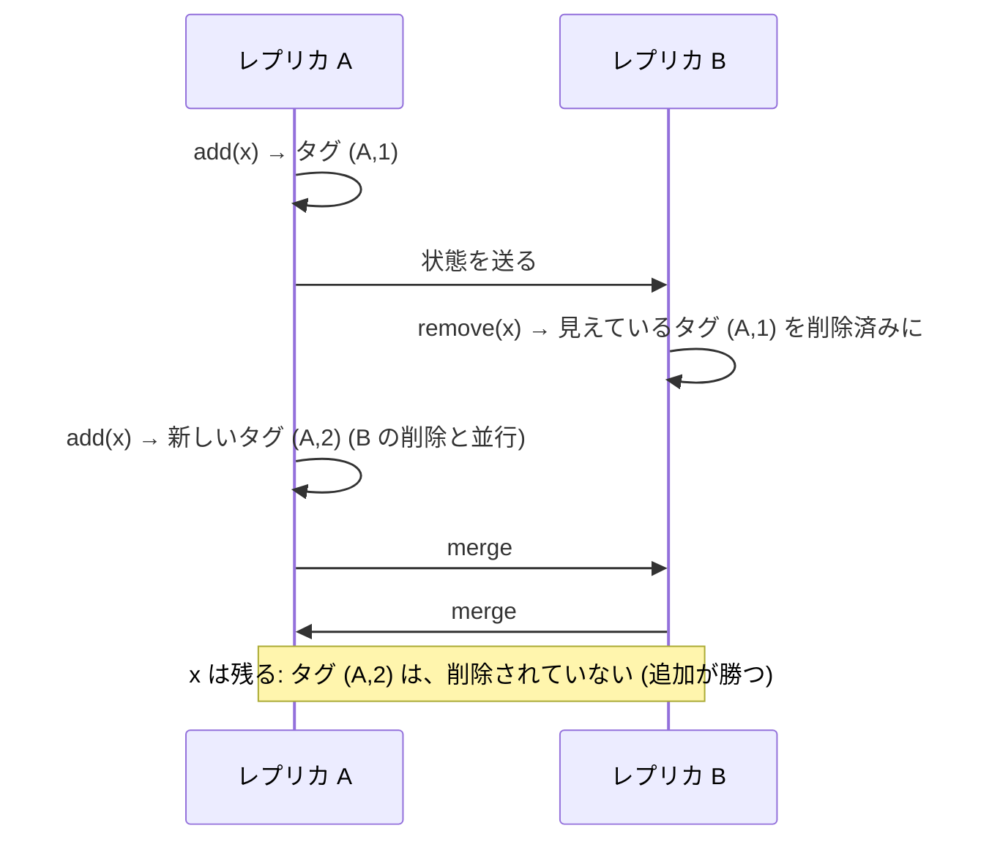
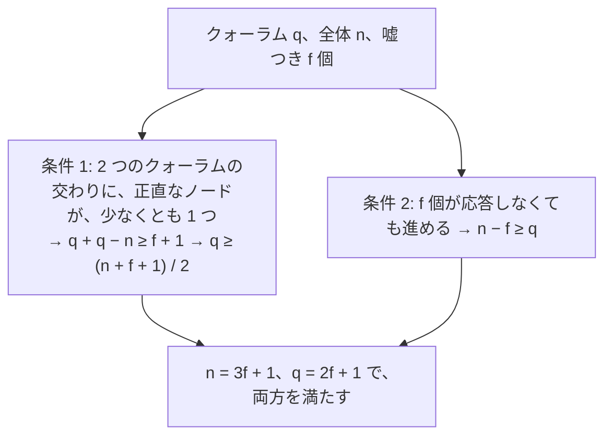
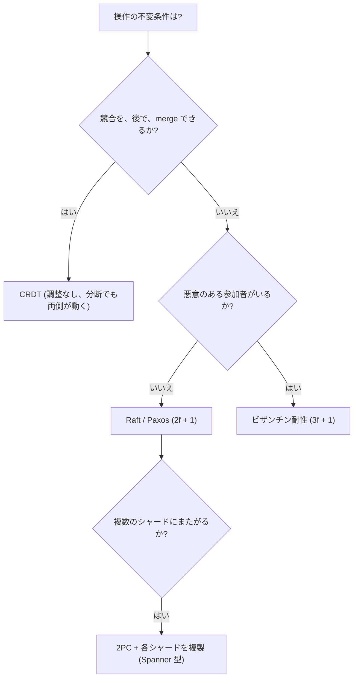

# 図4: CRDT とビザンチン耐性

## 1. 調整なしの収束


merge が、次の 3 つを満たせば、全レプリカは、同じ状態に収束する。

| 性質 | 式 | 何から守るか |
|---|---|---|
| 交換則 | a ∪ b = b ∪ a | 順序の入れ替わり |
| 結合則 | (a ∪ b) ∪ c = a ∪ (b ∪ c) | まとめ方の違い |
| 冪等 | a ∪ a = a | 重複 |

(数学的には半束。演習5: G-Counter、OR-Set、LWW-Register を 2 万組で検査 → 違反 0。)

## 2. G-Counter

```
 レプリカ 0: [3, 0, 0]       レプリカ 1: [0, 2, 0]
 merge (成分ごとの max):  [3, 2, 0]   値 = 合計 = 5
 並行な増加は、失われない。再送しても (冪等) 値は変わらない。
```

素朴な「値の max で merge」: レプリカ 0 が 3、レプリカ 1 が 2 → max = 3 (合計 5 のはずが 3)。演習5: **200 / 200 で、合計と食い違った**。

## 3. OR-Set (追加が勝つ)



| 設計 | 演習5 の結果 |
|---|---|
| OR-Set | 200 / 200 で収束。追加勝ちも 200 / 200 |
| 素朴な集合 (削除をローカルのみ) | 192 / 200 で、削除した要素が復活 |
| 2P-Set (削除したら再追加できない) | 198 / 200 で、再追加が失われた |

## 4. 収束 ≠ 意味が正しい

| データ | CRDT で足りるか |
|---|---|
| いいねの数、閲覧数 | 足りる (G-Counter) |
| 買い物かごの商品の集合 | 足りる (OR-Set。追加勝ちが、仕様か要確認) |
| 共同編集のテキスト | 専用の CRDT がある |
| 残高 ≥ 0、在庫の最後の 1 個 | **足りない** (調整が必要。CALM、第12回) |

## 5. ビザンチン故障と 3f + 1



| 故障 | f 個に耐えるのに必要なノード数 | 例 |
|---|---|---|
| クラッシュ | 2f + 1 | Paxos、Raft |
| ビザンチン | 3f + 1 | PBFT (メッセージは O(n²)) |

3f + 1 = 4 (f = 1): クォーラム = 3。2 つのクォーラムの交わりは、少なくとも 2 ノード。うち 1 つが嘘つきでも、もう 1 つは正直。

(この講義では、ビザンチン故障の実装と実験は、していない。)

## 6. 方式の選び方


