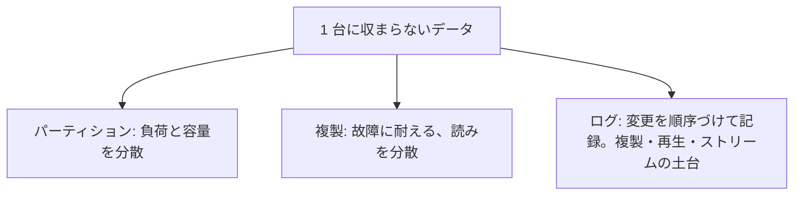
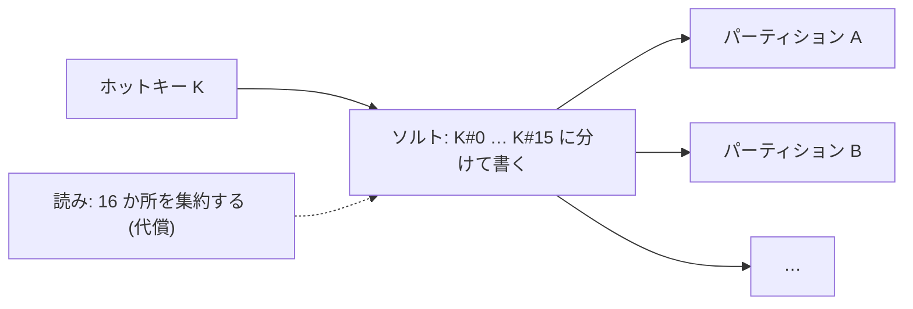
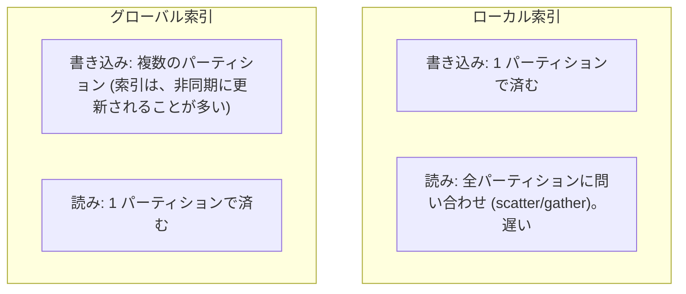

# 図1: パーティショニング

## 1. 3 つの基本の部品



## 2. ハッシュ分割と範囲分割

```
 ハッシュ分割:   key → hash(key) → パーティション        範囲分割:   key の順序で、範囲を分ける
 [a][b][c][d][e]...  散らばる                             [a-f][g-m][n-s][t-z]  隣り合う
```

| | ハッシュ分割 | 範囲分割 |
|---|---|---|
| 負荷 | 均一 (連番のキーでも) | 偏りやすい (時刻順、人気のキー) |
| 範囲検索 | できない (全パーティションに聞く) | 効率的 |
| 代表 | Dynamo、Cassandra、Redis Cluster | Bigtable、HBase、Spanner |

## 3. 演習5 A: 偏り (100 万書き込み、16 パーティション。偏り = 最大 ÷ 平均)

| キーの分布と分割 | 偏り | 最も忙しい 1 つ |
|---|---|---|
| 連番 + ハッシュ | **1.00** | 6.3% |
| 連番 + 範囲 (現在の範囲に集中) | **16.00** | 100% |
| Zipf(1.2) + ハッシュ | **3.69** | 23.0% |
| Zipf(1.2) + 範囲 | 14.83 | 92.7% |
| Zipf(1.2) + ハッシュ + 上位 100 キーをソルト | **1.24** | 7.7% |

```
 Zipf(1.2) の、パーティションごとの負荷 (ハッシュ分割)
 P0  ████████████████████████████████████████████████  23.0%   ← 人気のキーを持つ
 P1  ██████                                             ...
 …   (残りは、約 5〜6%)
 1 つのキーは、1 つのパーティションにしか置けない
```



(連番 + 範囲の 100% は、「常に最後の範囲に書く」という、モデルの仮定から、ほぼ自明に出る結果。)

## 4. リバランス

| 方法 | 内容 | 注意 |
|---|---|---|
| 剰余 | hash mod ノード数 | ノード数が変わると、ほぼ全て移動 (第10回: 約 90%) |
| 一貫性ハッシュ + 仮想ノード | 移るのは約 1/ノード数 | 第10回 |
| 固定数のパーティション | 多めに決めて、ノードに割り当て。パーティションごとに移す | パーティション数は、後から変えにくい |
| 動的な分割 | 大きくなったら分割、小さくなったら結合 | Bigtable、Spanner |

自動リバランスの危険: 故障の誤検出 → リバランスの負荷 → さらに遅くなる (第15回の連鎖)。

## 5. 副索引


