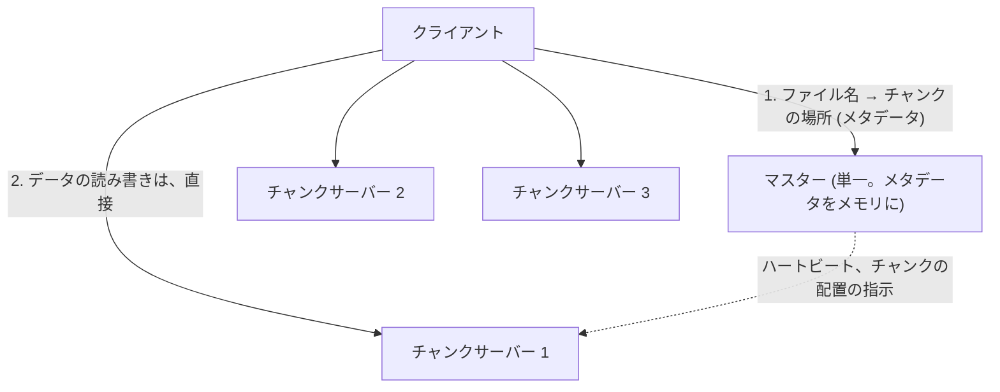
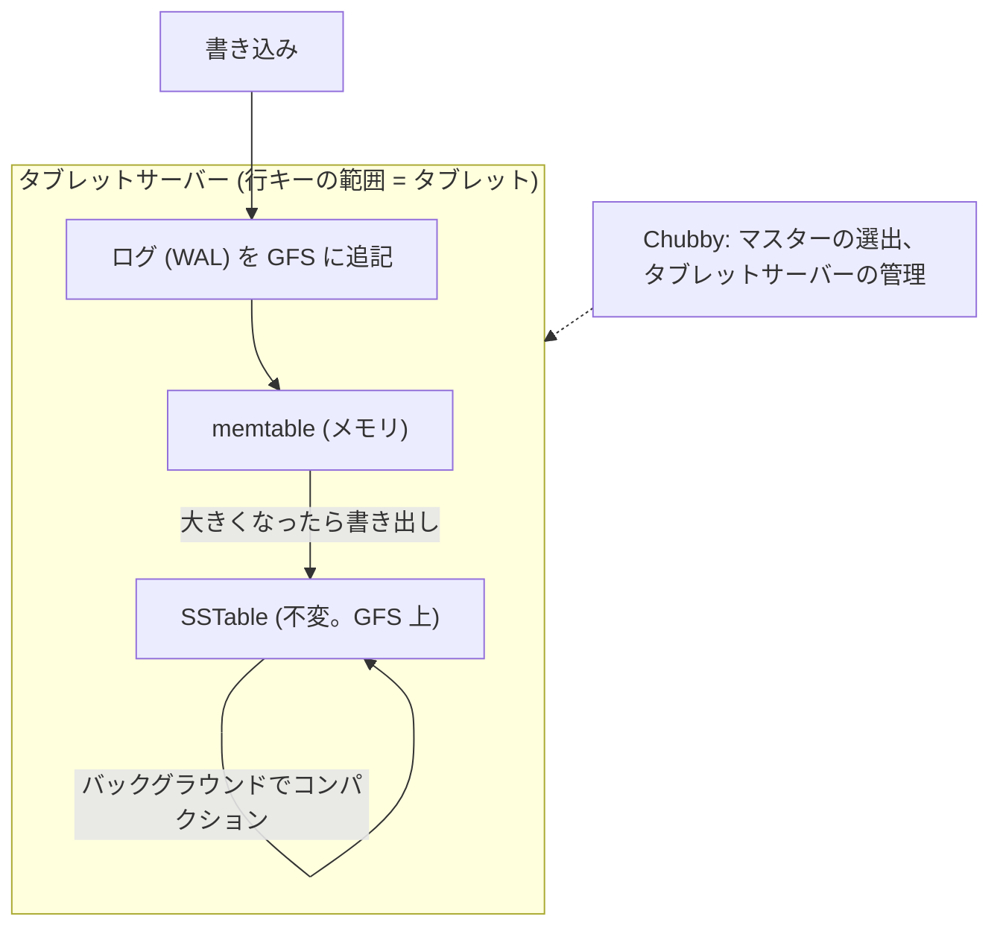
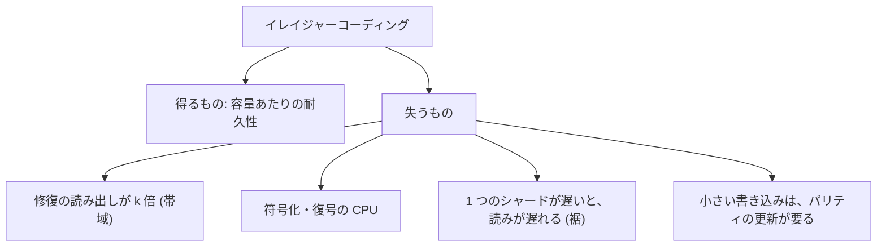

# 図2: GFS / HDFS、Bigtable、イレイジャーコーディング

> GFS、Bigtable の構造は、公開された論文に基づく一般的な知識。この講義で測ったものではない。

## 1. GFS / HDFS



- ファイルを大きなチャンク (GFS: 64 MB) に分割し、複数のチャンクサーバーに複製 (既定 3)。
- マスターは、データの経路から外す (メタデータだけ)。
- 想定: 巨大なファイル、追記中心、順次の大量の読み。緩い一貫性 (追記は少なくとも 1 回)。

## 2. Bigtable



| 層 | 責務 |
|---|---|
| Bigtable | 読み書きの経路、行キーの範囲分割 |
| GFS | 保存と複製、耐久性 |
| Chubby | 分散ロック、調整 |

行内の操作はアトミック。行をまたぐトランザクションはない。

## 3. イレイジャーコーディング: 複製との比較 (演習3)

```
 複製 3 倍:   [データ] [コピー] [コピー]              容量 3 倍。2 つの故障に耐える。
 RS(10, 4):   [d1][d2]…[d10] [p1][p2][p3][p4]        容量 1.4 倍。4 つの故障に耐える。どの 10 個からでも復元
```

A. Reed–Solomon (GF(256)、Cauchy 行列) の実装。どの k 個からでも復元できるか (全ての組み合わせ):

| 構成 | 復元に成功 |
|---|---|
| RS(3, 2) | 10 / 10 |
| RS(6, 3) | 84 / 84 |
| RS(10, 4) | 1,001 / 1,001 |

B・C. 年間故障率 4%、故障は独立、修復は並列 (モデル):

| 構成 | 容量 | 耐える故障 | 修復の読み出し | 年間の喪失確率 (修復 1 時間) | (24 時間) |
|---|---|---|---|---|---|
| 複製 2 倍 | 2.00 | 1 | 1 倍 | 3.65e-07 | 8.76e-06 |
| 複製 3 倍 | 3.00 | 2 | 1 倍 | 2.50e-12 | 1.44e-09 |
| RS(6, 3) | 1.50 | 3 | 6 倍 | 1.92e-15 | 2.65e-11 |
| RS(10, 4) | 1.40 | 4 | 10 倍 | 1.74e-19 | 5.76e-14 |



- 修復が遅い (24 時間) と、耐久性は桁違いに下がる → 修復の速さが耐久性を決める。
- 数値は、故障が独立という仮定による。実際の障害は相関する (ラック、電源、同じバグ)。相対的な違いの方向だけを読む。
