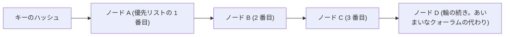
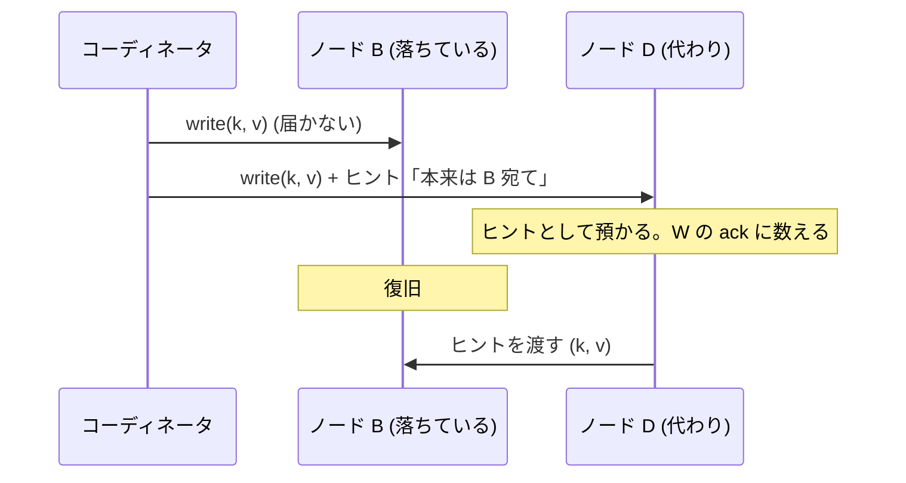
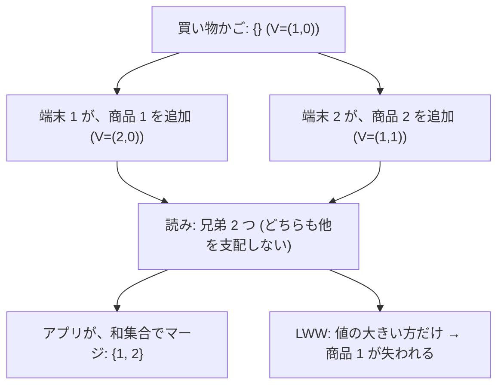
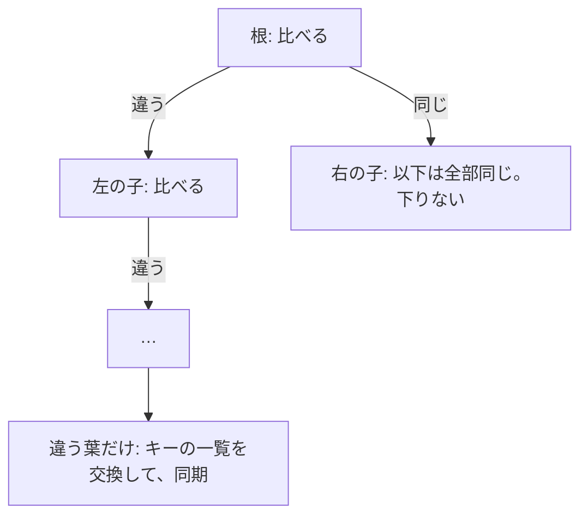
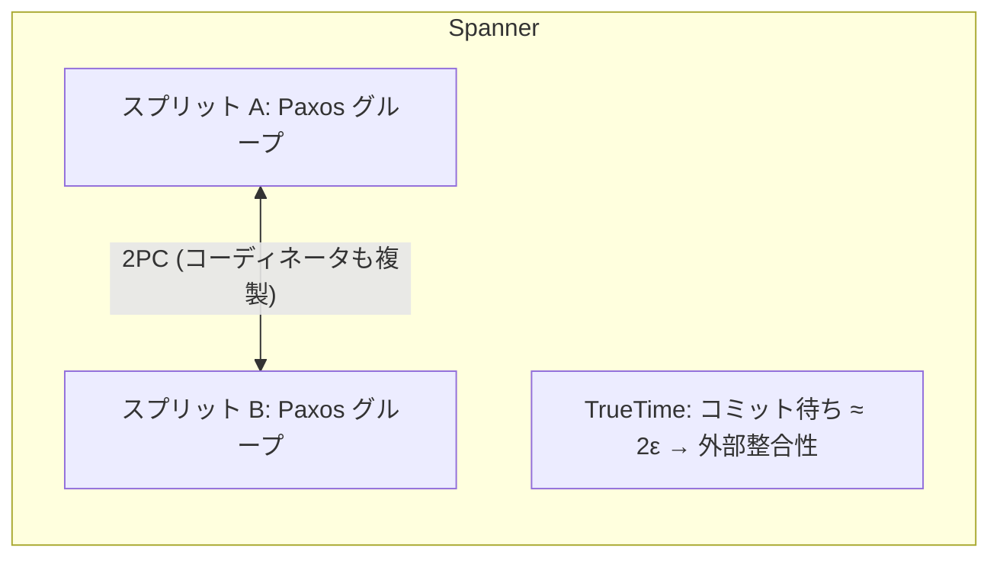

# 図3: Dynamo 型と Spanner

## 1. Dynamo の輪と優先リスト



N = 3: 優先リストの 3 ノードが、複製を持つ。書き込みは W 個、読みは R 個の応答を待つ。R + W > N なら、重なる。

## 2. 部品

| 部品 | 解決すること |
|---|---|
| 一貫性ハッシュ + 仮想ノード | 負荷の均一化、ノード増減での、移動の最小化 |
| クォーラム (N, R, W) | 一貫性と可用性の、調整 |
| あいまいなクォーラム + ヒント付き引き継ぎ | 優先リストのノードが落ちても、書ける |
| ベクタークロック | 並行な更新の検出 (兄弟) |
| 読みの修復 | 読まれたキーの、古いレプリカを直す |
| アンチエントロピー (Merkle 木) | 読まれないキーも含めて、レプリカを同期 |

## 3. ヒント付き引き継ぎ



## 4. 演習1 A: 可用性 (k 個が落ちている。成功した操作)

| 設定 | k=0 | k=1 | k=2 | k=3 | k=4 |
|---|---|---|---|---|---|
| 厳密 R=2 W=2 | 100% | 100% | 89.2% | 71.0% | 49.4% |
| 厳密 R=3 W=3 | 100% | 62.1% | 35.9% | 17.7% | 7.2% |
| あいまい R=2 W=2 (ヒント) | 100% | 100% | 100% | 100% | 100% |

## 5. 演習1 B: 古い読み (ノードの故障・復旧を、20 万ステップ)

| 設定 | 操作の失敗 | 古い読み |
|---|---|---|
| 厳密 R=1 W=1 | 4.08% | 28.91% |
| 厳密 R=1 W=1 + 読みの修復 | 4.08% | 12.86% |
| 厳密 R=2 W=2 | **26.83%** | **0.00%** |
| あいまい R=2 W=2、ヒントなし | **0.35%** | 18.77% |
| あいまい R=2 W=2、ヒントあり | 0.35% | 4.66% |
| 厳密 R=3 W=3 | 70.59% | 0.00% |

```
 一貫性 ←──────────────────────→ 可用性
 厳密 R=3 W=3 (古い読み 0%、失敗 70.6%)    …    あいまい + ヒント (古い読み 4.7%、失敗 0.35%)
```

(同期的な模擬。ネットワークの遅延による、古い読みは含まない。)

## 6. 兄弟 (並行な更新)



## 7. Merkle 木 (演習2: 10 万キー、k 個が食い違う)



素朴な方法に対する、通信量の割合:

| k | 葉 2^10 | 葉 2^14 | 葉 2^17 |
|---|---|---|---|
| 1 | 0.1% | 0.0% | 0.0% |
| 100 | 9.7% | 1.4% | 1.2% |
| 1,000 | 62.2% | 10.9% | 8.7% |
| 10,000 | 99.4% | 62.9% | 54.0% |

違いが少ないと、100 分の 1 以下。違いが多いと、利点は薄れる。木の構築のコストは、数えていない。

## 8. Spanner との対比



| | Dynamo 型 | Spanner |
|---|---|---|
| 一貫性 | 結果整合性 (調整可能) | 外部整合性 |
| 競合 | 兄弟。アプリが解決 | トランザクションで防ぐ |
| 分断の間 | 両側が動く | 多数派の側が動く |
| 通常時の遅延 | 低い | 高い (同期の複製) |
| PACELC | PA/EL | PC/EC |
