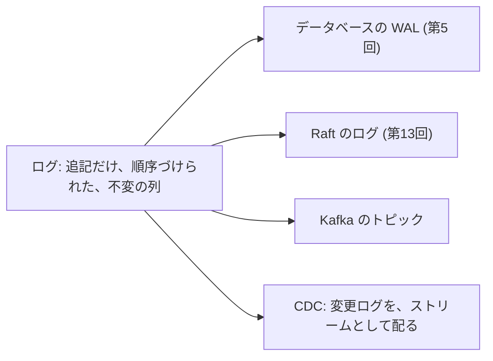
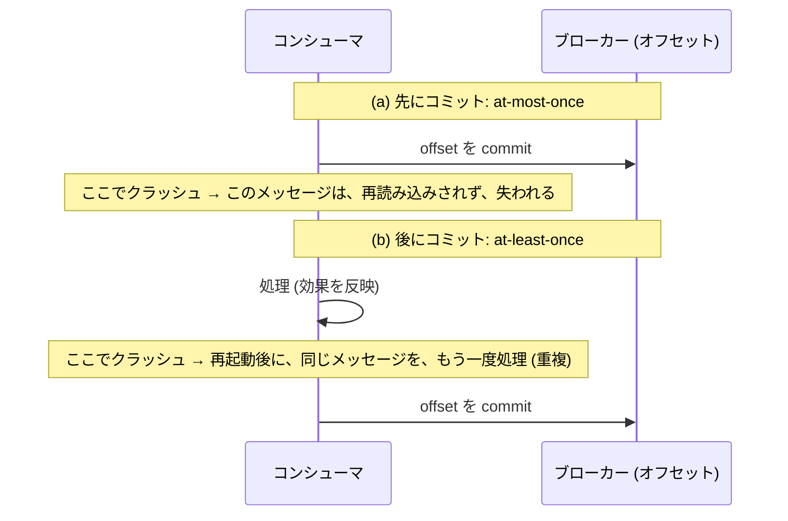
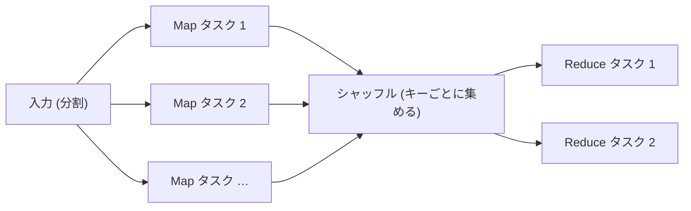
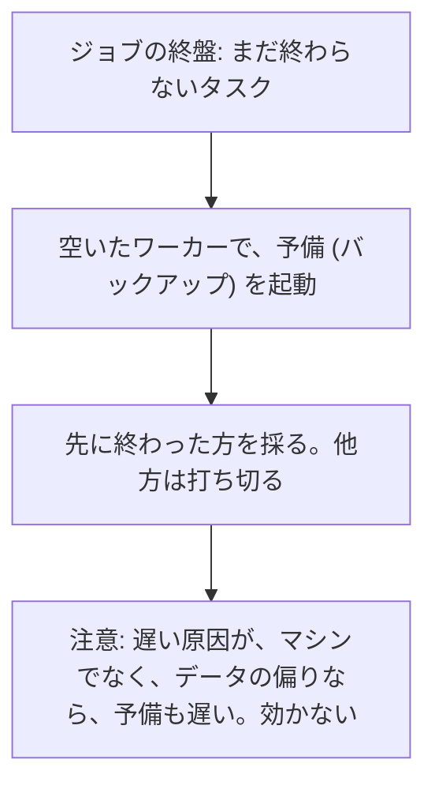

# 図4: ログ (Kafka 型) と MapReduce

## 1. ログという抽象



## 2. パーティションされたログ

```
 トピック (3 パーティション)
 P0: [0][1][2][3][4][5] →      同じキーは、同じパーティション (hash(key) mod P)
 P1: [0][1][2][3] →            パーティションの中の順序は、保たれる
 P2: [0][1][2][3][4] →         パーティションをまたぐ順序は、保証されない

 コンシューマグループ: 各パーティションは、グループ内の 1 つのコンシューマだけが読む
     C1 ← P0     C2 ← P1     C3 ← P2          (並列度の上限 = パーティション数)
```

## 3. 演習4 A: 順序

| パーティション数 | 同じキーの逆転 | 異なるキーの組の逆転 |
|---|---|---|
| 1 | 0 | 0.0% |
| 4 | **0** | 0.8% |
| 16 | **0** | 2.1% |

## 4. 配達の保証 (演習4 B: 100 万メッセージ、クラッシュ確率 0.001)



| 方式 | 失われた | 重複 |
|---|---|---|
| 先にコミット (1 件ずつ) | **1,000** | 0 |
| 後にコミット (1 件ずつ) | 0 | **1,001** |
| 後にコミット (100 件ごと) | 0 | **50,463** |
| 後にコミット (100 件ごと) + 冪等な処理 | 0 | **0** |

「ちょうど 1 回」= at-least-once の配達 + 冪等な処理 (id で重複を無視)、または、効果とオフセットを 1 つのトランザクションで反映。

## 5. 並列度と偏り (演習4 C: 到着 3/ms、1 コンシューマ 1/ms)

| P | C | キー | 最も忙しいパーティションの到着 | 安定か |
|---|---|---|---|---|
| 4 | 4 | 一様 | 0.75 /ms | 安定 |
| 4 | 16 | 一様 | 0.75 /ms | 安定 (12 台が遊ぶ) |
| 4 | 4 | Zipf 1.2 | **1.37 /ms** | **不安定** |
| 16 | 4 | Zipf 1.2 | 0.78 /ms | 不安定 (C が足りない) |
| 16 | 16 | Zipf 1.2 | 0.78 /ms | 安定 |
| 4 | 16 | Zipf 1.2 | **1.37 /ms** | **不安定 (コンシューマを増やしても無駄)** |

1 つのパーティションの到着が、1 コンシューマの能力 (1/ms) を超えると、遅れ (lag) が増え続ける。

## 6. MapReduce



タスクは決定的 → 失敗したら再実行できる。

## 7. 遅いタスク (演習5 B: 1,000 タスク、100 台。完了時間)

```
 ジョブの完了 = 最も遅いタスクで決まる

 ワーカー 1  ████████ 完了
 ワーカー 2  ████████ 完了
 …
 ワーカー 7 (遅い)  ████████████████████████████████ ← 全体を待たせる
```

| 遅いワーカー | なし: 平均 / p99 | 投機的実行あり | 追加の仕事 |
|---|---|---|---|
| なし | 11.7 / 12.8 | 11.7 / 12.8 | +0.6% |
| 2% が 10 倍遅い | **17.0 / 28.0** | **12.0 / 14.8** | +0.7% |
| 5% が 10 倍遅い | **21.2 / 30.4** | **12.4 / 17.0** | +0.9% |
| 20% が 3 倍遅い | 15.6 / 18.6 | 14.2 / 17.3 | +1.8% |



(「遅いのはマシン」という仮定のモデル。データの偏りによる遅さは、模擬していない。第15回: リクエストのファンアウトでも、同じ構造 — ヘッジされたリクエスト。)
