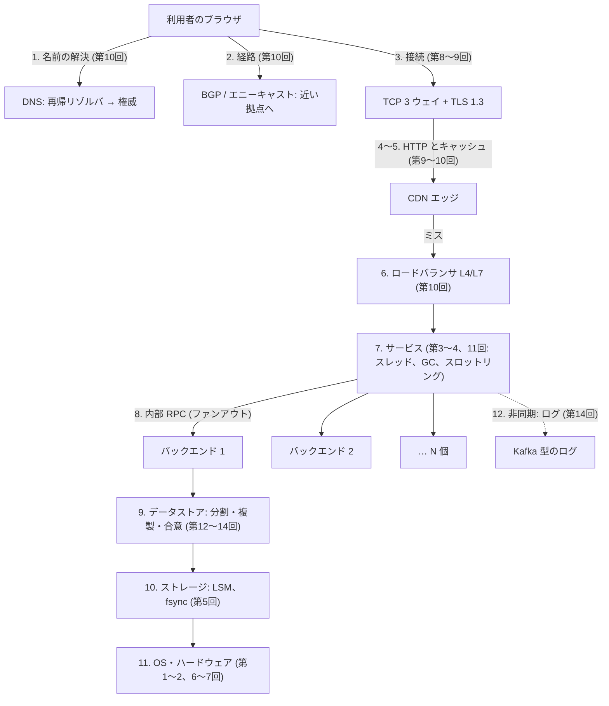
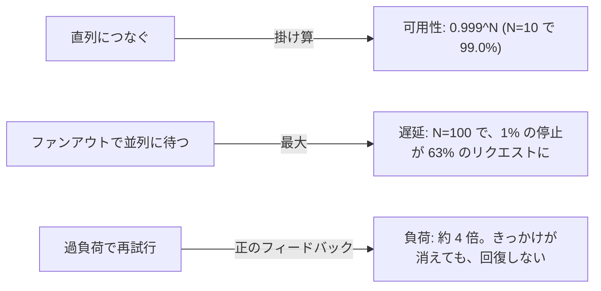
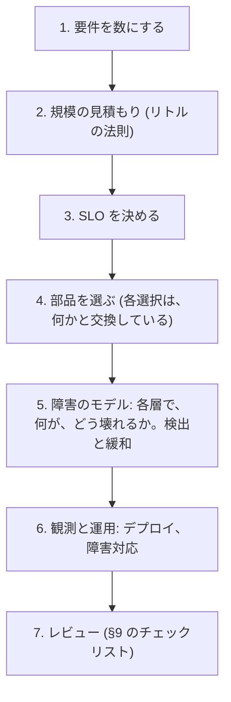

# 図1: 全層を貫く、リクエストの旅

## 1. 写真を表示するリクエストの経路



## 2. 各段階の、典型的な失敗

| 段階 | 失敗・コスト | 対処の考え方 |
|---|---|---|
| DNS | 古い答え (TTL)、プロバイダの障害 | 複数のプロバイダ、TTL の設計 |
| 経路 | リーク、乗っ取り、エニーキャストの切り替わりで接続が切れる | ROV、短い接続に向ける |
| 接続 | 往復の遅延、輻輳、証明書の期限切れ | 接続の再利用、証明書の自動更新 |
| キャッシュ | スタンピード | 合流 (coalescing)、stale-while-revalidate |
| LB | 偏り、ヘルスチェックの誤検出、再試行の嵐 | P2C、再試行の予算 |
| サービス | GC の停止、スロットリング、ロック競合 | メモリの設計、GOMEMLIMIT、CPU の上限の設計 |
| ファンアウト | **遅延の裾の増幅**、依存の可用性の合成 | ヘッジ、縮退、依存の削減 |
| データストア | 偏り、古い読み、リーダー交代、2PC のブロック | 分割の設計、一貫性の選択 |
| ストレージ | 書き込みの増幅、fsync の遅延 | バッチ、LSM の調整 |

## 3. 3 つの増幅



## 4. 遅延の桁 (第1回から。おおよそ。環境による)

| 操作 | 桁 |
|---|---|
| メモリ | 約 100 ns |
| SSD の読み | 数十〜百 µs |
| 同じデータセンター内の往復 | 約 0.5 ms |
| 大陸間の往復 | **約 50〜150 ms (光の速度の限界)** |

大陸間の往復は、アプリでは、どうにもならない。CDN、複製の配置、非同期で、避ける。

## 5. 設計の進め方



## 6. 規模の見積もり: リトルの法則

```
 同時に処理している数 L = 到着率 λ × 滞在時間 W
 例: 100,000 リクエスト/秒 × 0.05 秒 = 5,000 (同時)
 → スレッド数、接続数、メモリ (1 リクエストの使用量 × 5,000) の出発点
```

演習2 B: ランダムな時刻に数えた L = 4.01、λ × W = 4.02 (ほぼ一致。分布によらず成り立つ)。

## 7. 総合課題 (設計演習): メッセージと写真のサービス (1 日 5 億人、読み書き比 100:1)

| 問い | 関連する回 |
|---|---|
| 利用者を、近い拠点へ (DNS、エニーキャスト、CDN) | 10 |
| 写真 (大きい、不変) とメッセージ (小さい、頻繁) の保存先。複製か、イレイジャーコーディングか | 14 |
| フィードのファンアウト (書き込み時 / 読み込み時)。有名人のホットキー | 14、15 |
| 自分の投稿がすぐ見える (read-your-writes)。友人のフィードの古さ | 12 |
| 分割と複製。リージョンの障害に耐える | 13、14 |
| SLO とエラーバジェット | 15 |
| フィードの組み立て (ファンアウト 100) の、遅延の裾 | 15 |
| 過負荷 (バズ) に、何を捨てるか | 15 |
| デプロイ (カナリア) と、ロールバック | 15 |
