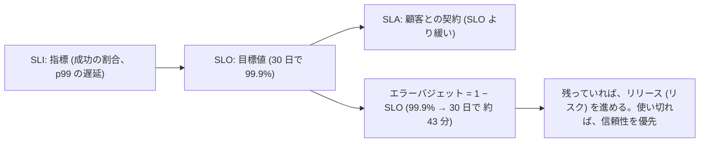
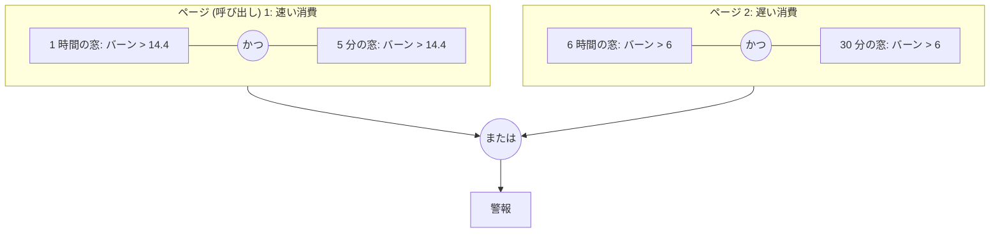

# 図2: SLO、エラーバジェット、可用性の合成、バーンレート

## 1. 用語



## 2. 可用性の合成 (演習5 A)

各依存先が 99.9%、全てに直列に依存:

| N | 可用性 | 許される停止 (月) |
|---|---|---|
| 1 | 99.900% | 43.2 分 |
| 3 | 99.700% | 2.2 時間 |
| 10 | 99.005% | 7.2 時間 |
| 30 | 97.043% | 21.3 時間 |
| 100 | 90.479% | 68.5 時間 |

自分の SLO は、全てに直列に依存するなら、依存先の SLO を超えられない。対策: 依存を減らす、縮退、キャッシュ、非同期。

## 3. 冗長化と、障害の独立性

2 つのコピー (各 99.9%)。停止のうち、共通の原因 (同じデプロイ、同じ設定、同じ電源) の割合 c:

| c | 可用性 | 許される停止 (月) |
|---|---|---|
| 0% (完全に独立) | 99.99990% | 2.6 秒 |
| 10% | 99.98992% | 4.4 分 |
| 50% | 99.94998% | 21.6 分 |
| 100% | 99.90000% | 43.2 分 (冗長化の効果なし) |

```
 停止時間 (月、対数目盛りの模式図)
 c=0%    ▏                       2.6 秒
 c=10%   ████                    4.4 分
 c=50%   ████████████████        21.6 分
 c=100%  ████████████████████████████████  43.2 分
```

共通の原因が 10% でも、独立の場合の 100 分の 1 の効果に落ちる (単純なモデル)。同時の配布は、冗長化を無効にする。

## 4. バーンレート

```
 バーンレート = 実際のエラー率 ÷ バジェット (1 − SLO)
 1  : ちょうど 30 日で、バジェットを使い切る速さ
 14.4: 1 時間で、月のバジェットの 2% を消費
 6   : 6 時間で 5%
 1   : 3 日で 10%
```

## 5. 多窓・多バーンレートの警報



- 長い窓: バジェットを、有意に、使っている。
- 短い窓: 今も、続いている (すでに、収まった事象で、鳴らない)。

## 6. 演習5 B: 警報の方針の比較 (30 日 × 100 回。大きな障害 3、ゆっくりした劣化 4 (8 倍)、短いスパイク 30)

| 方針 | 大きな障害: 検出 / 見逃し | ゆっくりした劣化: 検出 / 見逃し | 月の警報 / うち不要 |
|---|---|---|---|
| 1. 5 分 > 0.1% | 0.0 分 / 22 | 1.0 分 / 8 | 35.5 / **28.4** |
| 2. 5 分 > 1% | 0.0 分 / 3 | 177 分 / **231** | 33.3 / 28.4 |
| 3. 1 時間 > 1.44% | 1.0 分 / 1 | 162 分 / **365** | 3.1 / 0.0 |
| 4. 多窓・多バーンレート | 1.1 分 / 7 | 238 分 / **4** | 8.0 / **0.9** |

(見逃しは、大きな障害 300 回、ゆっくりした劣化 400 回のうちの数。検出時間は、検出できたものの平均。)

注意: 最初の設定 (バーンレート 5 倍) では、方針 4 は、ほぼ全てを見逃した (しきい値 6 倍より遅い)。8 倍に変更した。恣意的な変更で、方針 4 に有利。5 倍なら、より長い窓のチケットレベルの警報が要る (実装していない)。

## 7. バジェットの内訳 (1 回の模擬)

```
 大きな障害 (3 回)         ██████████████████████████████████  34.7%
 ゆっくりした劣化 (4 回)   ██████████████████████████          26.7%
 短いスパイク (30 回)      █████████████                       13.9%
 平常時のエラー            ████████████████████                20.0%   ← 目立たないが、5 分の 1
 合計 95.2% (SLO は守れたが、ほぼ使い切った)
```

## 8. SLO を決めるときの問い

| 問い | 内容 |
|---|---|
| 利用者は、違いを、感じるか | 99.99% と 99.9% を、区別できるか |
| コストは | 9 を 1 つ増やすごとに、コストは大きく増える |
| 依存先の SLO は | 自分の SLO の上限 |
| バジェットを、どう使うか | リリース、実験、計画停止 |
