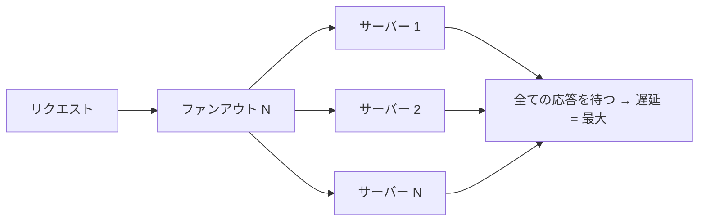
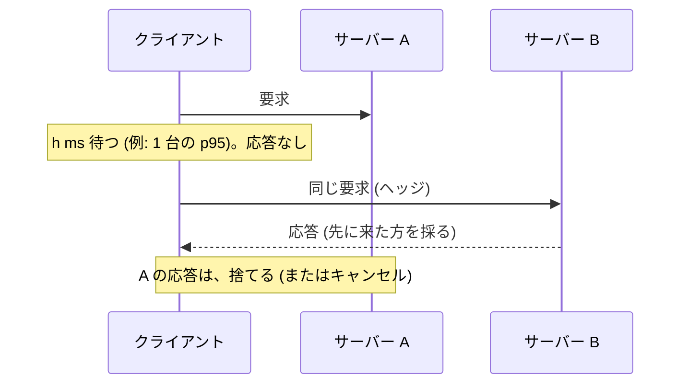
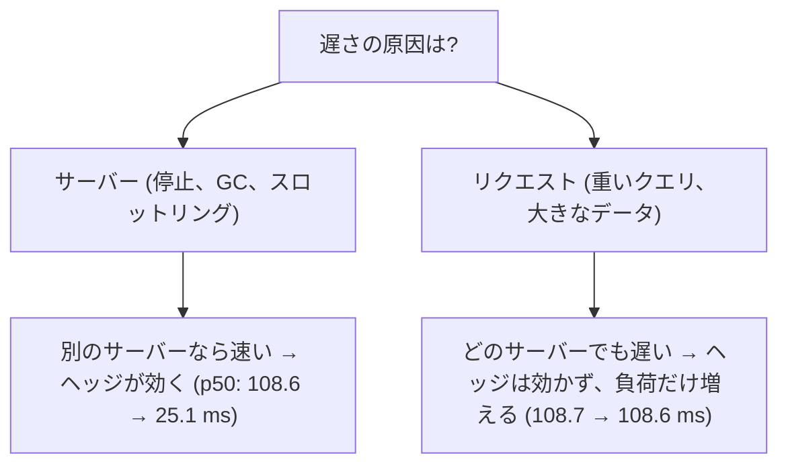
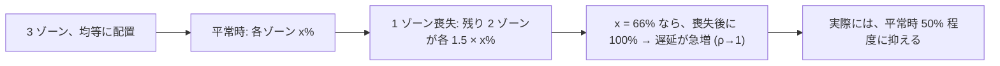

# 図3: 遅延の裾と、待ち行列

## 1. ファンアウトによる増幅



1 台: 中央値 10 ms の対数正規 + 1% の確率で +100 ms の停止。演習1 A (各 20 万リクエスト):

| N | p50 | p99 | 100 ms 超 (実測) | 理論値 1 − 0.99^N |
|---|---|---|---|---|
| 1 | 10.1 | 27.4 | 1.0% | 1.0% |
| 10 | 16.0 | 114.6 | 9.5% | 9.6% |
| 100 | **108.6** | 120.1 | **63.3%** | 63.4% |
| 1000 | 115.6 | 125.3 | 100.0% | 100.0% |

```
 100 ms 超の割合
 N=1     █                                          1%
 N=10    ██████████                                 9.5%
 N=100   ██████████████████████████████████████████████████████████████  63%
 N=1000  ████████████████████████████████████████████████████████████████████ 100%
```

## 2. ヘッジされたリクエスト



演習1 B (N = 100):

| h | p50 | p99 | p99.9 | 追加の負荷 |
|---|---|---|---|---|
| なし | 108.6 | 120.0 | 124.6 | 0% |
| p50 (10.0 ms) | 20.9 | 37.2 | 114.3 | **50.1%** |
| p90 (14.9 ms) | 24.2 | 103.3 | 114.9 | 10.0% |
| p95 (16.9 ms) | **25.9** | 47.8 | 114.3 | **5.0%** |
| p99 (105.6 ms) | 108.6 | 117.3 | 120.2 | 1.0% |

- h が短い: 追加の負荷が大きい。h が長い: 効果がない。
- p99 は不安定: 両方のコピーが停止に当たる確率 (約 1e-4 / サブリクエスト) が、N = 100 では約 1% のリクエストに起き、p99 はその崖の縁にある (推論。独立には検証していない)。

## 3. ヘッジが効かない場合 (演習1 C)



## 4. 待ち行列: 使用率と遅延 (演習2 A。平均の処理時間 = 1)

| ρ | 指数: 平均 / p99 | 一定 | 裾の重い (σ=1.5) | 理論値 1/(1−ρ) |
|---|---|---|---|---|
| 0.30 | 1.4 / 6.6 | 1.2 / 2.9 | 3.0 / 37.9 | 1.4 |
| 0.50 | 2.0 / 9.2 | 1.5 / 4.3 | 5.5 / 64.6 | 2.0 |
| 0.70 | 3.3 / 15.3 | 2.2 / 7.5 | 11.4 / 108.9 | 3.3 |
| 0.90 | 9.9 / 43.9 | 5.5 / 23.0 | 40.2 / 252.6 | 10.0 |
| 0.99 | 93.2 / 366.3 | 46.4 / 192.1 | 642.3 / 2912.9 | 100.0 |

```
 平均の滞在時間 (指数)
 100 ┤                                                    ●  ρ=0.99
     │
  20 ┤                                          ●  ρ=0.95
  10 ┤                                    ●  ρ=0.9
   5 ┤                          ●  ρ=0.8
   2 ┤              ●  ρ=0.5
   1 ┼──●──────────────────────────────────→ 使用率 ρ
```

- 実測は、M/M/1 の理論値とほぼ一致。
- 使用率 90% を超えると、わずかな負荷の増加が、遅延を大きく増やす。
- 処理時間のばらつきが大きいと、はるかに悪い。
- p99 の目標を守るには、使用率の目標を低く (例: 50〜70%)。ヘッドルームは、遅延を守るためのコスト。

## 5. リトルの法則

```
 L = λ W        (演習2 B: ρ = 0.8)
 ランダムな時刻に数えた L = 4.01          λ × W = 0.80 × 5.03 = 4.02
```

## 6. キャパシティ: 障害ドメインを考慮した使用率


