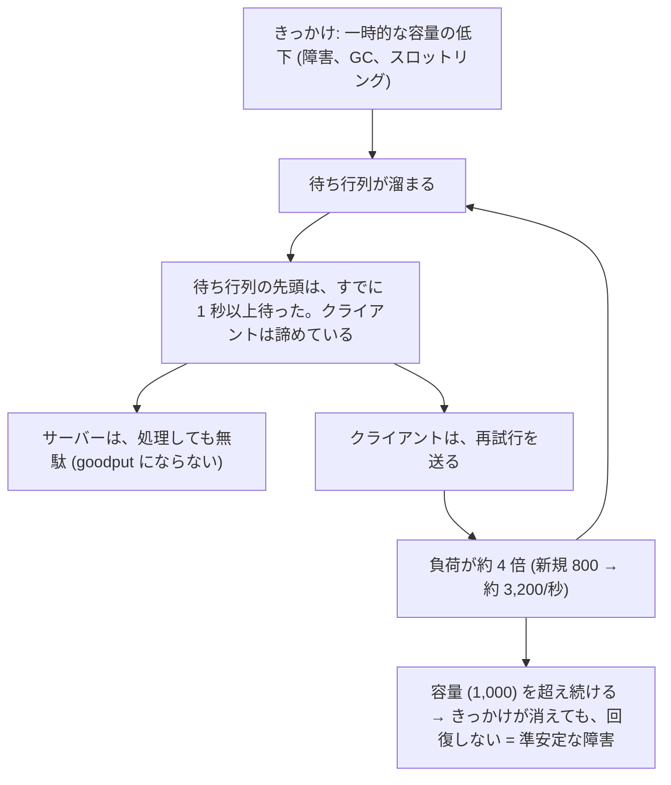
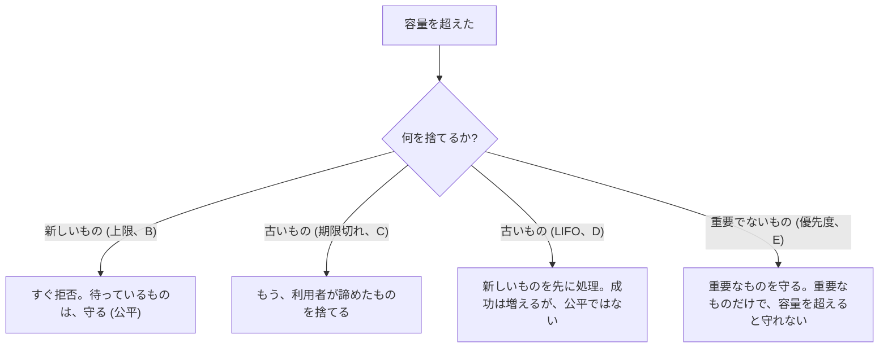
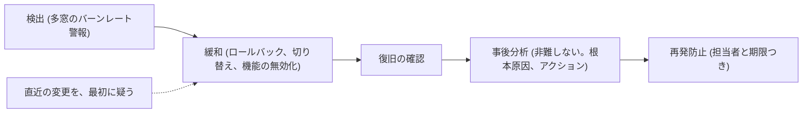

# 図4: 再試行の嵐、準安定な障害、過負荷の制御

## 1. 正のフィードバック



## 2. 演習3: 方針ごとの goodput (容量 1,000/秒、新規 800/秒。10〜15 秒だけ容量が 500/秒)

| 方針 | 11 秒 | 14 秒 | 16 秒 | 20 秒 | 30 秒 | 90 秒 | 回復 |
|---|---|---|---|---|---|---|---|
| 1. 再試行なし | 500 | 0 | 0 | 1000 | 805 | 779 | 19 秒 |
| 2. 即時に再試行 (3 回) | 500 | 0 | 0 | 0 | 0 | 0 | **戻らない** |
| 3. バックオフ + ジッター | 500 | 0 | 0 | 0 | 0 | 0 | **戻らない** |
| 4. バックオフ + ジッター + 予算 10% | 500 | 0 | 0 | 0 | 808 | 732 | 23 秒 |
| 5. 即時 + サーバーが期限切れを捨てる | 500 | 500 | 1000 | 1000 | 805 | 779 | **16 秒** |

待ち行列の長さ:

| 方針 | 30 秒 | 90 秒 |
|---|---|---|
| 1. 再試行なし | 0 | 2 |
| 2. 即時に再試行 | **38,030** | **169,582** |
| 3. バックオフ + ジッター | 37,043 | 168,375 |
| 4. + 予算 | 0 | 0 |

```
 goodput (/秒)
 1000 ┤       方針 5 ──────╲___   方針 1,4 ───── 回復
      │ ───╲                    ╲
  500 ┤     ╲
      │      ╲___________________ 方針 2, 3 : 0 のまま (準安定)
    0 ┼──────┴────┴────┴────→ 時間
      0    10   15   20
           きっかけ (10〜15 秒)
```

バックオフは、再試行の時刻を散らすが、総量を減らさない → このモデルでは、回復しなかった (他の定数では、回復する場合がある。確かめていない)。

## 3. 演習4: 過負荷の制御 (容量 1,000/秒。goodput /秒)

| 方針 \ 到着率 | 500 | 1,000 | 1,200 | 1,500 | 2,000 | 3,000 |
|---|---|---|---|---|---|---|
| A. 制御なし | 496 | 996 | **210** | **104** | **67** | **50** |
| B. 待ち行列の上限 100 | 496 | 996 | 1000 | 1000 | 1000 | 1000 |
| C. 待ち時間 100 ms 超を捨てる | 496 | 996 | 1000 | 1000 | 1000 | 1000 |
| D. 適応的な LIFO | 496 | 992 | 1000 | 1000 | 1000 | 1000 |
| E. 優先度 | 496 | 992 | 1000 | 1000 | 1000 | 1000 |

```
 goodput
 1000 ┤              ●━━━━━━━━━━━━━━━━━  B, C, D, E (容量の近くを維持)
      │            ╱
  500 ┤       ●
      │  A (制御なし): 容量を超えると崩壊 → 210 → 104 → 67 → 50
    0 ┼──┴────┴────┴────┴────┴────→ 到着率
      500  1000 1200 1500 2000 3000
```

重要なリクエストの成功率 (到着率 2,000/秒):

| 方針 | 成功率 |
|---|---|
| A | 3.3% |
| B | 50.2% |
| C | 50.3% |
| D | 50.6% |
| **E (優先度)** | **100.0%** (重要な到着率 400/秒 < 容量) |

## 4. 何を捨てるか



## 5. 対策の一覧

| 対策 | 内容 |
|---|---|
| 負荷の遮断 | 容量を超える分を、早く、安く拒否 |
| デッドラインの伝播 | 期限切れを処理しない (方針 5 が最速で回復) |
| 再試行の予算 | 再試行を、新規の一定割合に制限 (方針 4) |
| バックオフ + ジッター | 時刻を散らす (総量は減らさない) |
| サーキットブレーカー | 下流の失敗が続いたら、呼び出しを止める (本文のみ) |
| 優先度 | 重要なものを守る |
| バックプレッシャー | 下流が上流に「待って」(第4、8回) (本文のみ) |
| 縮退 | 機能を減らして続ける (本文のみ) |
| オートスケール | 反応が遅い (数分)。最初の数分は間に合わない (本文のみ) |

## 6. 障害対応の流れ



変更の管理: カナリア → 段階的な展開 → 自動ロールバック。全拠点に同時に配らない (共通の原因が、冗長化を無効にする)。
